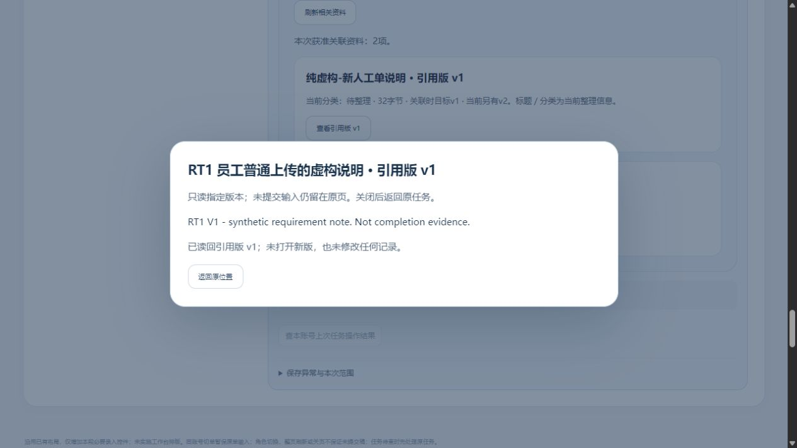

# 资料普通上传、明确关联与业务入口整段实测

2026-10-31 · revision 1。承接用户“好的，我们继续”，沿资料接续r1、回复草稿r1的下一段。项目外隔离虚构小样，不是正式员工软件或公司真实资料试用。

**本轮实际走通：普通文件选择器上传v1 → 保存资料 → 明确关联原人工单及已发布任务 → 查回受控迟回的两次关联 → 普通补交v2 → 从订单／任务打开引用v1 → 资料中心另读v2。** 本批资料不再由API预置，当前角色仍是实验协调演示员，不能称真实员工权限已配置。

## 如何接入与复用

复用原资料中心files.js及其已有接口；将index中的资料中心区块接进当前manual-review，并添加同页导航。不改资料保存／关联业务API或表结构。目录控制按钮的范围排除files表单，避免订单模块代管资料按钮。此前任务回复保稿和PDF资源沿用原源码，未据“沿用”声称本轮重新验遍。

两个输入是项目外预先写好的纯虚构UTF-8 txt：v1为61字节，v2为66字节；用户操作由CUA按普通文件选择器、输入和按钮完成。512 KiB只是既有实验上限，不是公司产品限制。没有公司原件、微信聊天、截图识别、视频、Agent调用或新组件安装。

## 普通页面的实际结果

1. 在资料中心明确选择文件，保存“RT1 员工普通上传的虚构说明”，得到新资料DOC-34993e548d944e2c。没有另存一份同名资料。
2. 选择订单O-78ba953ddd184a47，明确关联资料v1。再选择已发布任务TK-35b86f7e75944059，明确关联同一v1。无默认第一对象，不把选单当授权。
3. 两次关联的HTTP响应均由实验开关在服务提交后延迟1.5秒，而页面POST等待1秒；页面出现“结果待查”，新建／关联暂锁。分别点“查本账号上次资料操作结果”找回同一成功关联，未点击另建、重试POST或重新上传。受控迟回不等自然网络故障／任意崩溃验收。
4. 用普通文件选择器新增v2，资料中心读取所选v2得到新原文；订单及任务入口仍显示“引用v1，当前另有v2”，打开的是v1原文。两个版本逐字节及SHA与本轮输入相同。
5. 订单页另写的未提交跟进，查看引用返回后仍保留。切到另一张同名客户订单，其相关资料为空，不带走本单引用。
6. 后来打开“保存一份新资料”，填写另一标题与文字但不保存；查询历史version操作成功后，这份新输入保持。它没有产生第二份资料。

## 数据与方法核对

| 核对 | 实际增量／结论 |
| --- | --- |
| 资料 | 1份、当前v2；2个版本；1条初始元数据；1条本人grant |
| 引用 | 正好2条：原订单1条、已发布任务1条，均固定资料v1／目标所见v1 |
| 原操作 | 正好4条：create 1、link 2、version 1。迟回查回没有再造link或create |
| 旧数据 | 三库其余业务表除demo_sessions逐值保持；允许增量的六张资料表原行全部保留。订单明细、原话、任务发布／回复、正式进展、安排和实际物流没有改 |
| 存储 | 原76对象文件逐字节保持；新增6个对象存储文件，其中2个原件blob、4个原操作intent，不能说上传了6份资料 |
| 源与收尾 | 上游202根文件哈希保持；RT1自身HTTP／PG／U盘符正常停，cleanup_errors为空。176内部项主要为表级保护，不是176个功能 |

本轮普通页面没有故意制造错误文件、版本冲突或实际撤权；此前相关有限研究仍按原版本读，不能据本轮“全链”称全部异常通过。该操作链是资料中心到**既有**新人工单和已发布任务，不含本轮从零创建订单、下发新任务，也不等整套业务产品全链。没有普通分类整理、真实上报或任务草稿附件的新结论。

源码／夹具／前后快照／trace及文件字节均在项目外materials-roundtrip-prototype-20261031；业务项目只放报告及虚构截图。实验开关只在本轮运行进程启用，默认不故意延迟；未更改生产网络或账号。没有新的Git提交、公开发布或关机。

## 下一步

已补上“资料靠API预置”的这段操作缺口。下一优先核对完整首批使用路线的入口和剩余门槛：哪些能够从页面开始办理，哪些仍依赖夹具或单独小样；结合现有最小试用清单收拢，不把多个独立实验拼成已交付。真实授权、加工完成依据、维护承接和草稿附件继续按原清单保留，不向实习生重复发整套问题。

依据：[资料操作稿](../../软件开发计划+施工清单/页面与原型/资料中心人工归档与业务引用操作稿.md)、[新入口及固定版实测](2026-10-31-新人工单任务资料入口与PDF资源接续实测.md)、[回复草稿保护实测](2026-10-31-任务回复草稿失权恢复与范围隔离实测.md)。
