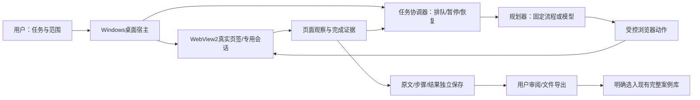

# 独立 Windows 浏览器任务工作台

2026-10-30，r2。状态：用户要求按日常聊天方式实施，并多次明确继续；S1基础操作预览0.1.1已实现并作有限实测，模型规划和三类专项任务仍未完成。r1的候选/未开发叙述按当时时点保留在下文，当前以本节和第8节为准。新主题承接网络运营工具，不扩ERP建设范围，不替换现有案例库。

## 1. 已确认需求与第一版形态

本轮用户要求把浏览器内置到软件，让助手在其中运行需要真人操作的网页任务。用户明确选择独立Windows软件、其中可打开现有素材库；三类任务都要：资料搜索/整理、短视频及评论研究、其他日常网页操作。这里保留三类目标，不把“都想”解释为所有网站及任意操作已经支持。

建议产品名暂为“隆实浏览器任务工作台”。打开后是一个桌面窗口：上方地址栏/页签；中间真实网页；右侧任务输入、步骤和结果；固定可见的开始、暂停、人工接管按钮。首页给出三类任务入口和现有案例库入口。网页占主要空间，技术日志折叠。

首段验收的是浏览器和通用动作底座：真实网页导航、标签页、专用会话、任务步骤、暂停接管、记录与结果保存；在公开网页与合成页上跑搜索/点击/滚动/读取任务。后续在这一个底座里逐项验证三类场景，逐平台显示已验证能力。不能用只有输入框、没有执行器的页面交付，也不能用首段通过宣称全平台评论采集通过。

现有素材库 http://127.0.0.1:58129/ 作为一个原生浏览器页签直接打开，不用iframe嵌套；其服务与原数据库继续独立。新工具的评论原文和通用任务结果不直接混入原库的完整三段案例。

## 2. 一次任务怎样工作

例：用户输入“在指定网站找S136锈蚀讨论，保留问题、回复和出处”，选择本次允许的网站、所用账号会话、时间/页面/模型预算。

1. 软件展示任务范围与拟执行步骤；使用已授权的搜索、打开、滚动、展开和读取动作。
2. 执行器读取当前页结构，必要时在获准的页面截取画面；规划下一步并调用受控动作。每步核对页面变化和目标页签，失败不会仅靠模型说成功。
3. 原始内容、链接、时间位置和范围先保存；分析与原文分存。短视频任务需要字幕/转写/关键画面时接已有工具，未取得的视频内容不声称已观看。
4. 人工接管后停止发出下一动作；已经在途的动作须回执/核页，不能假装能撤回已发生的点击。恢复时重新核当前页面和账号，不盲目重放上一写操作。
5. 完成后展示实际取得的内容、未完成原因和输出文件。只有明确痛点、原文实际措施和结果通过核查的内容，才可经明确的入库步骤进入现有案例库。

两种执行方式共用底座：固定流程任务适合重复搜索/读取；自然语言任务由模型逐步选择动作。先验证基础动作和固定流程，再启用有步数/时间/费用上限的自然语言循环，不承诺任意指令一定完成。浏览器本身不会产生模型能力，现有聊天里的助手也不会因嵌入网页就自动变成应用里的常驻执行器。

## 3. 选型与证据（2026-10-30核查）

| 层 | 候选及取舍 | 当前证据和未验证事项 |
|---|---|---|
| Windows内嵌浏览器 | 优先WebView2＋Windows桌面宿主；Electron＋WebContentsView作替代 | 本机有WebView2 Runtime目录156.0.4314.50和.NET Framework编译器；未发现标准安装位置的dotnet SDK。不把有运行时说成已具备完整宿主SDK。需固定WebView2 SDK/宿主依赖并编译、运行后再定具体打包路线 |
| 浏览器动作 | 优先验证Playwright与同一个WebView2会话；比较宿主原生控制接口 | Playwright官方有connectOverCDP连接示例；WebView2也有ExecuteScript/CallDevToolsProtocolMethod。前者能复用成熟定位和等待，后者可减少开放额外调试端口，但不能直接当Playwright的无成本替代。先实测同一页、弹窗与会话再定最终连接 |
| 自然语言执行 | browser-use优先验证，Stagehand作对照 | 两者固定源码LICENSE均MIT，均有本地执行路径；不采用其付费云浏览器。browser-use既有CDP参数放错层级的公开问题；Stagehand当前v4采用扩展参与执行，能否嵌入WebView2未验证，不按旧v3教程直接接 |
| 模型 | 用户现有DeepSeek为文字页面理解候选，模型适配和质量另验 | 当前素材库密钥加密保存在旧工具；本轮不复制、不解密展示、不调用、不提高预算。新工作台须单独明确凭据接入和任务费用上限；不是浏览器嵌好后就无限免费。视频/画面理解能力另按实际模型与既有媒体工具核对 |
| 存储 | 独立SQLite＋原件/结果目录 | 复用已验证的原文/派生结果分存和阶段检查点思想；不直接复用旧案例库表作为通用任务库 |

官方依据：

- [Playwright与WebView2](https://playwright.dev/docs/webview2)：同一控制实例通过CDP连接，用户目录隔离；不代表WebView2所有目标网站均已通过。
- [CDP限制](https://playwright.dev/docs/api/class-browsertype#browser-type-connect-over-cdp)：比Playwright自身连接协议支持程度低，须具体测。
- [WebView2用户数据目录](https://learn.microsoft.com/en-us/microsoft-edge/webview2/concepts/user-data-folder)：会话目录存放Cookie、权限、缓存等，目录应可写，不推荐网络盘。
- [WebView2宿主控制接口](https://learn.microsoft.com/en-us/microsoft-edge/webview2/reference/win32/icorewebview2?view=webview2-1.0.3537.50#calldevtoolsprotocolmethod)：内建异步控制接口存在，不代表本轮已编译验证。
- [Electron当前嵌入组件](https://www.electronjs.org/docs/latest/api/web-contents-view)：维护WebContentsView路径，不按已弃用BrowserView旧教程；Electron自带运行时的分发/更新代价需承担。

固定仓库快照（API与原始LICENSE/README均已保存）：

| 项目 | 提交 | 核查结论 |
|---|---|---|
| [browser-use](https://github.com/browser-use/browser-use/tree/b49a68e4060acb226da8f784194fef301c53a6d7) | b49a68e4060acb226da8f784194fef301c53a6d7 | 未归档，push 2026-10-30，LICENSE为MIT；Python本地库与付费托管服务分开，不引入其Bash/WSL示例为必需依赖 |
| [Stagehand](https://github.com/browserbase/stagehand/tree/b7a4b899079f198a0ee78a6dcb62ad02f545cf49) | b7a4b899079f198a0ee78a6dcb62ad02f545cf49 | 未归档，push 2026-10-30，LICENSE为MIT；主线v4。提交说明记录过截图产物写入目录和替换已有文件的问题及修复，采用时须显式指定项目外产物根，不能默认写进公司项目 |
| [Electron](https://github.com/electron/electron/tree/5c0934e9f197af079e270a3281d5d70d45203b3d) | 5c0934e9f197af079e270a3281d5d70d45203b3d | 未归档，push 2026-10-30，LICENSE为MIT；浏览器内核及分发附带的第三方声明另需保留 |

以上只是来源与许可文本核查，没有安装/运行或产品选型验收。WebView2 SDK/Runtime不笼统标为MIT开源。组件有MIT许可证也不代表其模型和云服务免费。维护时间不等于稳定性。

## 4. 模块、数据流与接口边界

宿主负责浏览器生命周期、页签身份、人工输入和接管；任务协调器独占任务页签并保存检查点；模型只返回候选动作/提取数据，不能直接拿到任意本地Shell/文件接口。外部网页不获本地宿主完整接口，页面内容不作为任务授权。

对上层提供beginTask、observePage、navigate、click、fill、scroll、read、pause、takeOver、resume、readResult等窄接口。每次调用带任务ID、账号会话ID、页签ID及页面版本；页面改变后旧定位失效。不是公开HTTP接口规格或已定DDL。跨进程选择受控本机通道；如果验证阶段启用CDP，只能绑定本机、限制运行期，禁止开放局域网和放宽任意Origin；不可证明控制边界时不启用真实账号。

记录分task、step、source、artifact、profile引用、usage几个概念：任务原指令/范围/预算；每步动作与前后页状态；原文来源及取得范围；截图/文件哈希；会话标识（不记录密码）；模型用量与请求结果。任务状态至少有待运行、运行、人工接管、暂停、待验证/登录、费用暂停、失败、完成。写操作响应不明时先查回，不自动重复提交。

代码/依赖/工作数据留项目外独立目录，候选为C:/Users/华硕/.codex/tools/longshi-task-browser/；研究与验收文档放本专题。用户安装后的会话和输出使用应用专用可写目录，分发前再确认可迁移位置，不借用日常Chrome账号目录。现有素材库只提供其已有浏览/导出与后续专门入库适配；先保证两边数据和服务不相互破坏。

## 5. 登录、接管及实际操作范围

用户在软件内自行登录，密码不发到聊天。专用profile由浏览器正常保存；会话是否仍有效由目标网站决定，不能承诺永不掉线。开始任务时明确所用会话和网站；登录/验证码/敏感输入时由用户处理，停止页面记录和模型观察，不录密码按键。人工接管后重新观察再续跑。

搜索、阅读、展开评论、整理和本地保存作为首轮通用动作；用户明确授权的具体表单任务可逐项扩充。发消息、发布、购买、删除等须按实际任务授权单独处理，不能从“通用任务助手”推导出对所有账号的无限写权限。没有授权的自动外发功能不作为默认动作。

自动化不提高网站权限；遇到登录过期、验证码、访问限制或页面不支持，返回实际原因并暂停，不通过身份轮换或绕过验证来凑结果。短视频页面显示的评论数量不代表已采集全量；不把只读字幕称已看完整视频。

## 6. 分段开发与验收追踪

| 用户要求 | 开发段/交付 | 验收动作 | 本轮状态 |
|---|---|---|---|
| 独立Windows软件、真实内置浏览器 | S1：可启动窗口、地址栏、返回/刷新、页签 | 打开两个真实公开网站；切页/返回；错误页有反馈 | 候选，未开发 |
| 保留账号登录 | S1：专用profile；合成会话先测 | 关窗重开验证合成会话；用户登录后再测具体平台 | 文档支持，未运行 |
| 让程序操作你看到的同一页 | S1：浏览器动作控制最小验证 | 唯一页标记、搜索/点击/展开/滚动、弹窗/换页；禁止操作错页签 | 文档支持，未运行 |
| 人工接管和暂停 | S1：独占与接管状态 | 运行中接管后不再发下一动作；页面变化后重定位再续跑 | 未运行 |
| 搜索资料和现有素材库 | S2：公开网页任务模板、库入口 | 真实关键词→来源原文→结果；直接打开旧库并导出，旧数据逐项保护 | 待S1通过 |
| 短视频/高价值评论 | S3：平台适配、视频上下文及原话 | 目标平台本人可访问样本，逐条核原话/回复关系/来源；优选与数量分开 | 范围保留，未接账号 |
| 其他网页任务/自然语言 | S4：执行框架小对照、受控任务循环 | 同一固定任务对照固定流程/模型；新页面变化、失败停机、步数/费用上限 | 候选框架已核，未接模型 |
| 能持续运行且可查回 | 贯穿S1—S4 | 中断恢复、来源去重、在途动作查回、模型失败、队列持久化、输出核验 | 未运行 |

S1先验证宿主/控制通道/同页会话这一关键组合，未通过则切换Electron候选并记录原因，不把卡住归咎用户账号。S1的技术样本通过后再用真实平台账号验收；不让用户反复测试开发阶段错误。S2—S4是工作依赖顺序，不是删除其他两类需求，也不是承诺四段已完成或给定工期。

### 首段完成应交付

可运行的浏览器壳、任务面板、公开/合成任务的实际录屏或截图与测试记录、已支持/未支持清单、启动与正常退出入口。仅文档或页面草图不算交付。真实账号首次登录由用户操作；其他可独立验证部分由助手完成，不把整套开发验收推给用户。

## 7. 当前完成与下一步门槛

已完成：用户本轮两项选择入档；学习库既有选型复用；官方文档和3个固定仓库源码/许可核对；本机既有Runtime/编译器只读盘点；形成模块/数据流、动作边界与验收卡。

未完成：新依赖安装、宿主编译和浏览器运行、Playwright/WebView2组合验证、真实登录、平台评论采集、自然语言Agent和模型调用、安装包交付。当前旧案例库服务/代码/数据保持原状。

【r1历史门槛；本轮用户已明确按聊天方式实施并继续】进入S1前按dev-planning约定，请用户确认这份具体范围后再正式开发；不是要求再次提供账号/密钥或填写技术问卷。S1通过不代表S3/S4自然通过。模型接入和费用、目标平台真实样本验证、分发/更新策略按相应阶段补证。

本轮外部证据在C:/Users/华硕/.codex/tmp/browser-workbench-plan-20261030/。学习库原条目为“抖音评论痛点软件浏览器与采集选型”，本稿是本轮扩为三类通用网页任务的新方案，未改写旧选型或他人原文。

## 8. r2：实际实现、验收与后续计划

用户指定“按日常的聊天窗口的说法来做”，随后明确“继续”“开始吧”“接着做”。当前S1采用左聊天、右真实浏览器；用短句发送基础动作，多步可分行。不是把网页放进普通iframe，也不是在软件里假装有完整模型助手。

### 当前已落地

- Windows .NET Framework WinForms宿主＋WebView2 SDK 1.0.4314.35，复用本机Runtime 156.0.4314.50；没有另外安装.NET SDK、Electron、Playwright或开源Agent框架。通过WebView2原生ExecuteScript等接口操作同一实际页签，不开放额外CDP调试端口。
- 基础指令识别、导航/搜索/链接/展开/滚动/读取/原文保存，任务进度、暂停/人工接管、切页暂停和正常关闭后继续。
- 浏览器与聊天使用独立会话目录；合成Cookie与localStorage在正常退出、重开后仍保留。没有访问真实平台账号或复制日常浏览器资料。
- 原文和输出范围分开标注；不会把搜索结果或保存网页自动判为合格三段案例。多article页面读取main区域，不能只拿第一条资料充当整页。
- 首段任务与聊天采用原子JSON快照/事件日志，暂未引入SQLite新依赖。S2扩大队列检索时再评估统一存储；这是实现取舍变更，不把候选SQLite说成已经采用。
- 新任务替代此前暂停任务时保留历史并标记cancelled；弹出新标签页先保存已发出的点击检查点再暂停，防继续时重点击旧页链接。404不能记作成功网页。

### 实际证据与范围

普通GUI已通过聊天实际执行6步合成流程及公开Example Domain导航；通过真实“我来操作”按钮在1/3步暂停，人工打开合成会话页、保存测试标记，正常关窗重开后看到Cookie与localStorage保持，继续后完成3/3。第一步文件哈希不变，完成事件只有一次。三次屏幕操作期间收到用户物理Esc，均按要求停止，后续用户明确恢复后才继续。

内部集成测试使用实际WebView2控件和本机合成网站、同一个应用动作管线，共19项通过；包含展开原文、弹窗暂停/继续、可信指针事件暂停、切页、请求边界、可见密码、404及不支持指令。可信指针由WebView2原生CDP合成，区别于物理鼠标测试；不把19项叫19个产品功能，也不称全网站通过。

公开回归实际打开Python官网、读取并保存原文和出处、打开原案例库并取得三段内容；没有调用Firecrawl云服务或模型API。修复了折叠设置中密码输入框的可见性误判，并回查真正可见密码页仍拒绝读取。原库仍12条完整案例、20条回收站，用量估算0.296922元不变。

两次公开回归失败（误把折叠密码框当登录、取第一article而未看到三段内容）保留在项目外qa/release-proof-01和02；第三次03通过，不覆盖旧失败。预览PNG由两个实际WebView2 CapturePreview渲染区域拼接，不是整桌面或原生标题栏截图，没有捕获用户的其他窗口。

证据：C:/Users/华硕/.codex/tools/longshi-task-browser/qa/ 下internal-02/checks.json、resume-verification.json、release-proof-03/release-proof.json和final-release.json；源码在同工具的src/、web/。0.1.1发布目录在releases/0.1.1，ZIP与预览在本专题outputs目录。包不含账号Cookie、测试profile、密钥或测试数据；没有对外发布或推送。

### 下一段怎样成为自动任务助手

1. S1底座已有限通过，可用基础操作预览，不等于完整AI浏览器交付。
2. S2先以免费本机发现/浏览器读取获取少量真实资料，保存出处、可用痛点线索和完整案例各自范围；复用旧素材库的去重/续跑/导出，不先搬整套Firecrawl服务。旧系统现有可选通道不因新浏览器默认免费就被宣称已全部移除。
3. S4中的任务规划能力要与S2一起做最小对照：同一个小目标，固定流程与候选模型各跑；比较是否找到有用素材、动作是否正确、失败会否停止及用量。先评估适合本机的本地模型，保留可选API，但本轮未选型、安装、调用或扩预算。不让BGE等检索模型冒充任务规划模型。
4. 在底座/规划实际可用后逐平台验证S3视频和高价值评论，再扩其他网页操作；三类范围保留。需要真人账号时本人登录，不凭库中历史账号建议直接访问。表单草稿与对外提交分开验收。

计划数据流仍为：聊天目标→规划器→受控动作→当前页观察→核对/下一步或暂停→原始资料→整理/审阅/导出。当前只有基础指令规划，没有任意目标自主循环。尚未验证真实平台登录寿命、完整短视频语义、评论全量、无限任务和多机安装升级。
