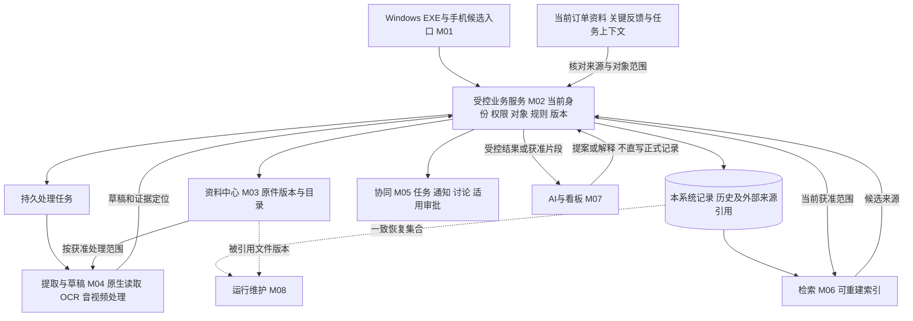

> 2026-10-27配套更新：[基础业务功能方案](../需求与范围/基础版功能总图与使用说明.md)已形成候选r2；功能与批次审阅以新稿为入口。本文历史技术/研究安排继续保留，不构成正式开工指令。

> 2026-10-27最新范围调整：原8模块主要是技术/资料处理职责，尚不能代表旧软件全部业务板块；需按基础功能清单重新映射后修订正式图纸。 先读[基础功能迁移清单](../需求与范围/基础功能迁移清单.md)。旧版正文保留，不表示已获正式开发批准。

# longshi 系统设计总图

2026-10-27；revision 4；1号汇总；proposed／可审阅设计草案。supersedes r3：按用户新方向以在途订单为核心，取消旧结果工具接入前置、改主图及相应职责/门槛；r3保全项目外。历史r3 supersedes r2：补第11节EXP-07有限PG确认机制证据与缺失阶段；r2保全项目外。第9/10节的“本轮只收敛、无运行”指当时设计工作段，当前新增实验严格按第11节，不是正式业务系统或公司规则批准。

**本稿把已有研究收敛成模块、数据交接和验收门槛，不是已批准技术栈、排期或开工清单。** 一周调研继续；下方未决条件未关闭，不能据本稿开始正式业务开发。技术来源沿原报告追溯，不复制工具、依赖或通用技能。

## 1. 先看公司会怎样使用

本系统优先服务未完成和正在进行的订单，已完成订单保留用于历史查询和数据分析。 进行中订单的建立、变化、反馈、协同与当前进度是本轮重点；历史订单的查看和分析继续保留。业务登记入口可由人工建立、已有资料整理或可靠任务上下文支持，均为待审操作候选，不要求先经过其他结果登记工具。

建议先审阅这条贯通链：**员工留关键资料 → 系统整理 → 人核对对象和内容 → 有权岗位确认适用结果 → 老板按权限查进度、看依据并下发事项。**

这是首版切入口候选，不删去文字、图片、文档、语音、视频、文件夹、混合检索、协同或按需看板的整体需求。报价、下单、采购、库存、加工、品质、交付和财务等调查域继续保留；不因现成平台的功能清单扩大实施范围。非订单资料可以独立归档，普通任务不必先有订单或附件。

已经明确的方向：先上传也可预选；系统建议分类和归属、员工核对；按类别决定上报时点；只补关键需求、变更和任务反馈；进度采用关键岗位确认、跟单查漏的混合方向；公司内外可用；AI不修改正式业务内容。具体公司岗位制度、首批类别及功能批次仍待核准。首句箭头表示职责联系和回环，普通事项可以先下发，不必等订单结果确认后才允许发任务。

## 2. 模块怎样配合

图是逻辑分工，一个框不等于一台服务器或一个微服务。建议先按模块保持接口清楚，再按资源和维护需要决定是否独立部署；不要求每台员工电脑装数据库、模型和Office服务器。

| 模块 | 输入、输出及负责的事 | 不可越过的边界 |
| --- | --- | --- |
| M01 电脑／手机入口 | 登录、选取资料、核对、事项操作、查看与按权下载；共用服务规则 | 不直连正式数据库，不保存服务端密钥；离线暂存若采用，只能显示未提交，不离线审批或确认当前进度 |
| M02 业务服务与记录 | 核当前身份、对象/动作/字段权限、可靠关联、规则和版本；产生本系统有权维护的有效记录及历史，提供受控查询 | AI、页面或后台任务不能绕过它写正式记录；字段按本系统已确认的维护权处理，不能因资料来源而自动授予修改权 |
| M03 资料中心 | 提交身份、字节暂存、完整性校验、不可变文件版本、逻辑目录、逐项状态及受控访问 | 文件名、内容相同不自动合并业务或权限；上传收齐不自动算登记、上报或业务完成 |
| M04 提取与草稿 | 按内容组成读取文本/单元格/图像/音轨，保留来源定位、不确定及处理版本，返回草稿 | 解析完成不证明字段归属、订单匹配或业务真实性；重提取不能覆盖新的人工核对，模型无正式写入凭据 |
| M05 工作协同 | 有权人员下任务、通知、围绕事项讨论、提交反馈及适用审批/验收；引用已有有效结果减重复录入 | 已发送、已读、已反馈、已批准、已执行、已验收分开；不把上传或一句“完成了”当全单完成 |
| M06 找资料 | 精确编号、关键词、向量候选与按需重排；结果回到获准版本/片段 | 授权覆盖候选、重排、模型输入和回看；相似不等同一订单，搜索无结果不证明业务为零 |
| M07 老板查询、AI及图表 | 问句解析为受控查询提案；业务服务按规则取数，展示单位、范围、时点、未知及依据；AI解释或整理草稿 | 不让模型自由生成SQL直跑正式库；图表绑定可信结果，引用有效/JSON合法仍不保证自由解释正确 |
| M08 运行与维护 | 身份生命周期、任务对账、备份恢复、索引重建、升级兼容、故障提示和受控审计 | 备份存在不等可恢复；不能恢复旧权限后立即开放，也不能把旧通知/确认操作全部重放 |

## 3. 数据必须带着什么身份流转

以下是概念对象与交接内容，**不是已定数据库表名、DDL或完整接口字段**。适用范围、数量单位、必填和保留规则尚待明确；不把这些都变成员工手填项。

| 对象族 | 必须能区分和追溯什么 |
| --- | --- |
| 提交与传输 | 操作身份、主体/范围、请求内容摘要、每件上传会话和服务端确认偏移；可查询结果未明的原操作 |
| 文件及清单版本 | 稳定文件/版本身份、实际字节大小/指纹、原显示名、逻辑相对路径及空目录；清单枚举/部分完成与文件状态分开 |
| 提取运行与片段 | 输入版本、解析器/模型及配置版本、页/格/框/时间戳定位、原输出与不确定原因；未采样不声称已检查 |
| 草稿与人工核对 | 草稿种类及版本、字段证据、原文与复述/推断区别、修正者和核对记录；同源可分别支撑沟通摘要与询价草稿 |
| 订单及来源关联 | 本系统稳定订单/明细/加工范围标识、来源证据及关联版本；客户同名、相近尺寸不作为唯一身份，不同批次类型分开 |
| 阶段结果及更正 | 适用对象/工序/批次、实际数量及单位、本次新增或累计的含义、依据、有权确认与版本；录错更正和实际返工分开 |
| 协同与审批 | 事项身份、参与/授权范围、所依据内容版本、反馈及有效结果引用；任务验收不替代阶段确认，审批不替代实际执行 |
| 查询与展示 | 当前授权范围、采用的有效记录/规则版本、单位、时间口径、覆盖缺口及来源；空集、未知与0分别表示 |
| 审计、处理任务与恢复集合 | 谁在何时对什么版本做什么、操作结果和派生水位；可恢复检查点、被引用原件版本及必要配置/记录的对应 |

业务发生时间、录入时间、确认时间、来源读取时间及查询数据时点分别保留。原件创建/修改时间不自动成为业务发生时间，最新上传也不自动成为当前有效制度或订单依据。

## 4. 交接时怎样判成功，失败怎样继续

下面是需要实现和验收的职责契约；当前没有正式API。读取原操作结果也核当前权，不能因为过去成功就向现已无权的人返回敏感缓存。

| 交接 | 可信输入和成功输出 | 不足／错误的结果及允许继续方式 |
| --- | --- | --- |
| 创建提交、查询与续传 | 有权主体及受控提交身份；按服务端偏移传输，逐项可查 | 请求结果未明先查原身份；过期、内容变更、撤权或偏移不符分别处理，不盲换操作键重传 |
| 登记原件版本 | 服务端核实际大小/内容校验和存储结果，再登记版本与引用 | 文件有但登记未定则保留待核；不能凭客户端声称上传完即返回已保存；跨文件/库故障尚待验证 |
| 提取、重提取及核对 | 指定输入版本和获准内容；新运行输出单独草稿，人工操作核期望草稿版本 | OCR/解析失败不删原件；迟到结果不盖新核对；混合内容、缺值和来源冲突按具体原因呈现 |
| 关联并确认适用结果 | 可靠对象范围、当前授权、已明确的数量/完成含义、依据、操作身份和期望业务版本 | 未对单可保存反馈，不推进订单；旧版本、无权、口径不明或冲突不生效，由可解释结果转待核/拒绝 |
| 下任务、反馈、审批／验收 | 人的明确操作和适用权限/版本；需要时引用同一有效阶段结果 | 提交反馈不自动结案；审批所依内容已变要重新核定；通知失败不能撤销已成立业务事实或冒充送达 |
| 搜索、业务查询、AI与导出 | 获准对象、片段及参数；正式数值由业务查询返回，图表按结果引用绑定 | 同名/范围歧义先澄清；无数据/数据旧有明确说明；生成及领取导出都核权，进度可见不自动开放整件原文 |
| 恢复后开放能力 | 隔离目标核一致检查点、被引用文件、人工更正、当前权与未完任务，再开放相应能力 | 缺文件/坏字节不当完整恢复；索引可重建，已发送副本不能承诺收回，未完传输元数据不保证续传 |

取消请求不等于取消已生效；与完成相遇时先查原操作，已经保存就明确告知。停止传输、取消提取、删除原件和撤销正式结果分别核权/处理，不能让一个取消按钮暗中完成全部动作。

两层防重必须分开：**同一请求重试**靠操作标识及绑定内容；**两次请求是否描述同一业务事实**靠对象/作业范围、来源与业务规则。更换操作键、换张截图或换个文件名，不能让“累计已做4件”再次作为“新增4件”。超时后的暂时查无结果不证明从未执行，不能因此立即换身份再确认；查询、重试及返回既有结果均须按当前权处理。

正式确认的记录、版本和必要审计在同一数据库事务中核验/提交是候选设计；后续索引、提醒等可使用同事务持久任务/待投递事件及可重复消费。它们不与原件存储自动成为同一事务，不承诺消息恰好一次。失败对账、撤权竞争及跨存储断点仍须专门验证。

## 5. 多种状态分别展示，减少重复填写

| 状态维度 | 设计中的区分及示例 |
| --- | --- |
| 传输和保管 | 未收齐、校验中、已保管、结果待核、原件暂不可读；各有含义 |
| 提取与关联／核对 | 提取排队/部分/失败/完成；关联未定/有候选/有依据；内容待核/缺项/已核分别显示 |
| 按类别上报 | 上报条件由类别规则决定；未定前不统一设“上传即上报”或“必须点提交” |
| 实际业务结果 | 未获确认、限定范围已有确认、更正/后续事件；加工完成可以与品质待复核并存 |
| 任务、审批及通知 | 任务反馈/验收、内容审批/执行及通知送达/已读各有状态，不串成一个万能完成百分比 |

尽量复用可靠任务/单据上下文，让员工核对本次变化和必要差异。有权且规则允许时可一次明确操作完成所需核对与确认，不预设每人必须点多轮，更不要求搬运全部微信聊天。员工负担是否实际降低尚待现场试用，不以流程图替代耗时证据。

沿用全虚构案例：明细需求10件，本加工范围的批次甲涵盖4件。岗位提供“这4件加工完成”，资料先保存；关联或权限未定时只留反馈。条件满足后记录本范围4件确认，任务另需验收则仍待验收。老板只看到获准范围及依据；另外6件未获更新，不能推成整单剩余6件、未开工或全单40%。品质、出货、签收及收款不由这条结果推定。

## 6. 技术放在哪里，哪些已有依据

下表是沿现有比较形成的条件性候选，不是采购或生产版本锁定。维护、核心许可证和依赖范围见[组件筛选](../../AI调研/技术调研/2026-10-26-核心开源组件筛选与补充调查.md)及[运行部署职责](../../AI调研/技术调研/2026-10-26-运行部署图与技术职责候选.md)；采用前还须核固定版本、依赖/模型/字体及分发许可。

| 具体职责／位置 | 优先论证的路线与对照 | 已有依据及不能据此下的结论 |
| --- | --- | --- |
| EXE与手机入口／客户端 | Tauri＋Web界面对照.NET WPF；手机轻量浏览器入口候选，共用API | 已查安装/平台机制；未在干净员工机或手机联验，未决定每机带Office或离线正式写入 |
| 统一API和校验／共享服务 | FastAPI/Pydantic与.NET等路线；身份采用成熟机制，Keycloak为候选而非必须 | JSON结构、授权内核有局部实测，不能当完整认证/权限系统；框架比较和真实角色仍有缺口 |
| 正式记录与文本／服务端 | PostgreSQL关系记录；pgvector等作语义索引候选，精确查询独立 | 合成SQL/BGE探针已跑；当前PG中文索引两配置有负结果，不能宣布混合搜索完成；SQLite仅本轮实验台账 |
| 上传及原件／受控服务端 | 大附件续传可用tusd/Uppy路线；受控文件目录与元数据对照对象存储 | tusd 2.10.1本机限定续传已有证据；Uppy前端、授权/配额/清理/并发崩溃未联验，不预选分布式存储 |
| 内容读取／隔离处理进程 | 原生文本/PDF/表格优先，图片按需PaddleOCR；音视频复用FFmpeg及Whisper/FunASR等候选 | 固定图片/表格/PDF有限对照，合并格/图片格等失败保留；合成视频工具跑通不等公司微信通话和专业词有效 |
| 后台处理／共享服务的worker | 持久处理任务＋worker为比较基线，负载需要成熟队列时比较Celery＋broker | 队列负责异步执行/重投递，不负责公司审批/验收；Windows非Celery官方支持平台，实验Linux模拟机不作生产部署 |
| 人工任务与审批／业务服务 | 简单流程先画显式转换表；确定Django且确有需要时评估django-fsm-2，Frappe按整平台对照 | 状态库不等完整派单产品，平台也不是可嵌入小库；不能把这些与Celery当同职责替代品，不为现成平台模块扩大范围 |
| AI、查询和图表／受控网关及客户端 | 模型提供草稿/受控提案，业务服务取数，ECharts等绑定结果 | 已做局部权限/结构和实际SVG对照；有效引用仍可能解释错，真实问句/语音和任意指标语义未整链验证 |
| Office／按任务分配位置 | 业务列表、XLSX读写、公式、预览/PDF、打印和协作分别选；原生库与LibreOffice/Gotenberg等对照 | 不把解析库当Excel重算器，不默认每台装完整Office或在线编辑服务器；公司模板打印和依赖分发未验 |
| 备份／独立故障域 | restic保管文件集合；PG一致备份按原生工具/pgBackRest等比较，恢复对账另由应用负责 | restic 0.19.1合成静止SQLite集合恢复已验并保留首失败；不证明生产PG、当前权、在线跨存储或恢复时限 |

共享主本、按需客户端副本是用户提出并要求分析的方向。服务放云还是公司、资料/模型能否外送、供应商/地域、运维人和费用未定。两条部署路线均经受控应用入口，数据库和原件目录不直接开放员工端；公司外可用仍需当前身份、授权和受控网络入口。

## 7. 需求、设计和验收怎样对上

沿用既有编号，PM-REQ为产品经理研究编号、UP/OP为对应专题编号、COV为调查域，均非新造的一套公司制度。下列是后续设计/验证包，不是已下发开发任务。

| 既有要求与调查域 | 本图落点／候选设计包 | 对应验收与当前证据 |
| --- | --- | --- |
| PM-REQ-01；COV-09/16/17 | M01/03/08：提交、版本、目录和恢复 | EXP-09/12已执行九类有限合成场景；首轮不足/失败及复测保留；下载权限、生产恢复仍未通过 |
| PM-REQ-02/03；UP-01—04；COV-10/11 | M03/04/02：先保存、分类建议、可追溯草稿及核对；沟通/询价双输出 | EXP-02/05有局部图文表格对照，EXP-03/04/13真实音视频/通话仍待；识别完成不代业务关联 |
| PM-REQ-04；OP-01—03；COV-01/02/03/07/18 | M02：对象与维护权、限定范围的进度结果 | EXP-07合成PG确认/版本竞争/回滚与更正已有有限证据，细阶段未采齐；真实明细/工序/批次、数量含义和完成定义仍未闭合，不凭语义匹配正式对单 |
| PM-REQ-05/07；COV-08/12 | M02/06：当前权、精确/关键词/向量与证据回看 | EXP-06/08局部探针/授权内核有证据；中文索引负结果、实际混合链和跨进程撤权未验 |
| PM-REQ-06；COV-04/13 | M02/07：受控统计结果、AI提案及灵活看板 | EXP-08结构绑定与两个SVG已有证据；真实指标口径、数据覆盖和自由解释准确性未验 |
| 用户已明确任务/通知/审批；COV-05/06/11/15 | M05/02：派发、讨论、反馈、适用审批和验收；品质措施/验证/关闭独立 | 已比较状态机制并纸面走查，真实类别路由/权限及提醒可靠性未定；不因报价审批未知漏掉全部协同 |
| PM-REQ-08；COV-14/16/17及跨域 | M01/02/08：原件不改、历史、Office、接入、升级及恢复 | EXP-10/11完整模板/安装/网络/升级未执行；已装组件及局部恢复不替正式运行验证 |

以上引用覆盖18个调查域的联系，不表示18域都调查完，也不代表培训、公海/交接、样品、维修、审厂等线索已获得首版实施批准。未进入当前贯通切片的项保留在[覆盖总表](../../AI调研/公开接续/功能与细节调研覆盖总表.md)，需按用途/来源/范围逐项收敛，不静默删除。

## 8. 哪些缺口阻止定稿，哪些工作可继续

这些是内部门槛组，不是要用户转发的问卷；已回答内容不重问。必要时由1号先查现有证据，只把影响当前节点的一个具体问题交实际负责岗位。

| 门槛组 | 阻止哪一步 | 补足依据的方式／可以先继续什么 |
| --- | --- | --- |
| 业务关联及语义 | 明细/工序/各类批次映射、数量新增/累计、完成/更正规则定稿 | 复用已有原件字段和反例，必要单点找跟单/PMC/实际确认岗位；可继续未关联资料保存及合成纸面图，不能放行正式进度累计 |
| 权限及制度 | 真实数据开放、确认/更正、分类上报、审批/验收路由及逐字段维护权定稿 | 复用岗位资料，具体授权由有决定权者确认；可画能力矩阵和允许/禁止案例，不能用岗位名称替批准 |
| 资料位置与外部依赖 | 服务/模型部署、原件外送和外网试用 | 老板/维护方明确可用环境、资料边界和正式环境访问授权。可继续两路线比较，不购云、不改生产网络 |
| 关键技术与恢复 | 正式确认防重/并发/崩溃、中文混合检索、PG与原件一致恢复及当前权对账 | 助手按真实缺口拟最小验证，已有实测直接复用；未获相应范围不追加运行，不将SQLite结果扩大为PG或在线一致性 |
| 现场使用与运维 | 承诺实时、容量/时限/保留/成本、目标设备打包升级及最终试用 | 用目标机、代表样本和实际岗位观察补证；不填虚构人天、预算或实时毫秒，不把老板想详细变成员工每句必填 |

收敛顺序是依赖关系：先明确贯通切片与对象/状态边界，再固定相关维护权和规则；据此核接口、权限和候选组件，验证关键剩余风险，随后形成可执行施工步骤及验收包。已知需求可并行细化，不必把其他问题全部答齐才画图；**真正进入正式开发前，相关关键门槛与范围须已明确并取得用户开工确认。**

## 9. 依据和本轮完成范围

业务依据：[主管主线](../../AI调研/公开接续/2026-10-26-主管流程图业务主线摘要.md)、[业务到系统对照](../../AI调研/产品经理调研/2026-10-26-业务流程与系统记录对照.md)、[记录维护权候选](../../AI调研/公开接续/2026-10-26-新旧系统记录维护边界候选表.md)、[字段与关联门槛](../../AI调研/公开接续/2026-10-26-进度记录字段来源与关联门槛.md)。

设计依据：[贯穿案例](../../AI调研/产品经理调研/2026-10-26-系统关系图与贯穿场景走查.md)、[关键反馈主链](../../AI调研/产品经理调研/2026-10-26-关键反馈到老板查询设计草案.md)、[保管契约](../../AI调研/技术调研/2026-10-26-原件保管版本与失败恢复契约草案.md)、[提取字段契约](../../AI调研/技术调研/2026-10-26-关键反馈提取草稿字段契约.md)、[查询展示契约](../../AI调研/技术调研/2026-10-26-老板查询结构化结果与展示契约草案.md)、[权限与一致性](../../AI调研/技术调研/2026-10-26-订单进度权限与一致性职责补查.md)。

技术及验证依据：[部署与职责](../../AI调研/技术调研/2026-10-26-运行部署图与技术职责候选.md)、[组件比较](../../AI调研/技术调研/2026-10-26-核心开源组件筛选与补充调查.md)、[上传及恢复实测](../../AI调研/技术验证/2026-10-26-资料上传版本与备份恢复合成实测.md)、[验证台账](../../AI调研/技术验证/验证计划与验收样本.md)。部分证据和原始实验环境只在原机受控保留，公开摘要不代替原件或可重跑环境。

本轮仅收敛设计并复核已有证据，没有新增业务代码、组件运行/安装、生产访问、公司资料外送或Git推送。跨窗口审阅按下列实际范围记录，不把任务已发出当审完，也不扩大为全稿或系统验证。

## 10. 定点回读和实际修订

1号实际读取2号业务切片（399）、3号六段交接（400）、4号十二类部件落位（404），原短交付及SHA保存在项目外，本稿按公司实际取用而非整套复制模板。2号407仅审r1第1/3/5/7/8节，核18域、候选切片、维护权/计数口径及非开工；3号405仅审第2—5/7/8节的身份/状态/确认/AI及失败验收，建议补取消分层；4号406仅审第2/4/6/8节的技术位置、有限证据及未决边界，建议拆开队列与人工流程的职责。

三方在各自指定范围未报硬矛盾，两项精确化已合入r2。原r1保全；这些回执不是r2整稿独立复审、公司制度确认、安全审计或新运行结果，既有实测仍按原条件及失败记录引用。

## 11. 确认机制的实际有限证据

[确认防重、并发、超时及更正实测](../../AI调研/技术验证/2026-10-26-确认防重并发超时与更正合成实测.md)已运行八CF和单独弱反例：真实PG独立backend锁位、操作键重放、版本条件冲突、提交后应用回复超时、异常回滚和原4/当前3更正有保存证据。弱实现缺少条件更新会双受理/覆盖。现有代码只为实验，不能当M02正式实现或已授予确认权。

部分细阶段未采完整表快照，NC原预期误用四表形状，后置静态r2纠正并保留旧错误；完整EXP-07不标通过。真实授权/撤权、关联与数量规则、任意崩溃/WAL、跨原件存储和通知副作用仍待。设计与验收引用本证据边界，不因试验结果锁定正式API/DDL。
