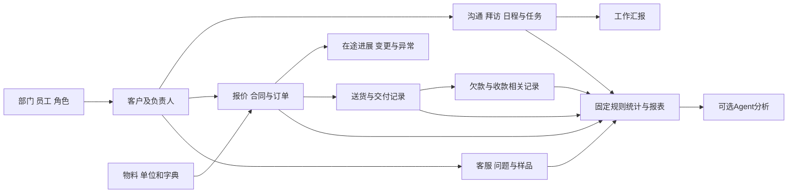

## 2026-10-30当前阅读说明｜revision 4

supersedes r3，r3字节留项目外line-task-handoff-prototype-20261030/docs-before-two-hour-results/11.md。仅按2号业务价值回查澄清标题／状态，不改B01—B36各行或范围。当前选单、原话与任务片段已有有限组合，完整迁移和正式员工试用尚未交付；源范围和各项内部规则缺口保持。当前成果见[本轮简报](../../AI调研/2026-10-30-两小时连续工作报告.md)，不能以几段小样覆盖整张功能表。

## 2026-10-29新增依据：运营获客与交接

用户明确运营从网上找客源后发给业务，见[去标识补证](../../AI调研/产品经理调研/2026-10-29-运营获客与线索分配-需求补证.md)。B01/B02/B03/B04/B12提供来源、线索、查重、归属和跟进的迁移归属；“询盘分派／接手”的具体流程是本次候选设计，不反推旧B04公海菜单已经具备它。多次询盘、客户归属、具体任务与报价／订单分别处理；当前无获客后台或自动抓取／微信外发。原36B行保持。

## 2026-10-29新资料：每日出货排单明确纳入

用户新给PMC群内核对、未排订单及每日出货排单4图，问计划是否包含。依据见[去标识需求补证](../../AI调研/产品经理调研/2026-10-29-PMC未出货跟进与每日出货排单-需求补证.md)：在B09交付及在途改进方向下明确补未出货／待安排清单、日期车次与时间／司机安排、业务补漏、改排版本和实际出货跟进。旧36行保留，不另造一套整单完成量；送加工与客户交付分开。此前有归属但细化不足，当前小样未实现；首批深度待对应收拢，不据此宣布已批施工或整组完成。

# 2026-10-29当前阅读提示

revision 3；supersedes r2，r2逐字保留项目外business-coverage-20261029/docs-before。仅补当前顺序／状态指针，原B01—B36各行、来源、缺口和原文保留。

**完整功能范围仍看下方36组；当前推进顺序已由用户选为在途订单＋任务＋资料先，新需求／报价紧接，Agent后续增强。** 下方§6步骤3的“候选先报价／顺序未批”是早期时点，不能覆盖后续决定；最新跟踪见[任务包§4](../施工与验收/首批开发任务包与规则依据.md)。局部小样已运行，但不等整组迁移或正式业务验收；[本轮岗位工作覆盖核对](岗位工作覆盖核对与下一批重点.md)分开写已有规划、实际小样和未闭合业务结果。

# 基础功能迁移清单｜旧软件对照

2026-10-27；revision 2；supersedes r1：合并2/3/4号对r1各自指定B组的回读，收紧目标/任务、权限/区域与打印证据，补首页周期比较及销售对比拜访列。r1保全项目外。1号协调整理。**当前主入口。**

用户已明确：`之前公司用的软件/`是需要迁移的基础功能依据；先做好不用AI大模型也能办理业务、查询和统计的系统，再增加Agent。停用旧软件的原因由用户提供：价格高、查看数据繁琐、不能加入Agent分析。

本清单接替此前“上传资料—AI整理—老板查看”及三页在途订单草图作为**整体功能范围入口**。在途订单依然是重要使用场景，但不能代替客户、销售、交付、款项、协同、汇报和管理等基础板块。旧稿及已发PDF保留作历史沟通稿。

**已确认的是产品方向和迁移依据；以下是有来源的功能盘点与候选行为，不是全部细则已核实、首批范围已批准或软件已实现。** 迁移总清单中的功能不能因缺页、暂时空列表或助手排序而悄悄删掉；批次与实现深度在功能审阅后确定。

## 1. 计划迁移的完整功能（以下不是已实现清单）

| 板块 | 基础系统负责的工作 | 主要关联 |
| --- | --- | --- |
| 客户管理 | 建客户、找客户、查重、分类、分配和交接，查异常客户 | 客户→负责人→沟通→报价/合同 |
| 销售与订单 | 管报价/合同记录、审核和落单，查当前及历史单据和目标 | 客户、业务员、物料、交期、明细 |
| 交付与款项 | 查送货、结算条件、欠款和逾期；收款统计入口保留 | 合同、送货、客户、期间；具体核销关系待核 |
| 跟进与日常任务 | 留沟通记录，安排拜访、日程和任务，查看反馈 | 客户、员工、时间、附件、待办 |
| 客服与问题处理 | 登记问题，派单、跟进、查询进度，管理问题资料和样品申请 | 客户、订单、问题证据、处理责任 |
| 汇报与审批 | 日/周/月/季/年工作汇报，办理适用审批 | 人员、周期、业务记录、审批事项 |
| 组织与基础配置 | 员工、部门、角色、业务员、物料和业务字典 | 控制各板块能看什么、能办什么 |
| 统计与报表输出 | 按时间和人员等条件查明细、合计、排名、趋势及对比，打印/输出 | 来自业务记录，采用明确规则，不让模型编数字 |
| 设备维修与审厂 | 保留旧菜单中的维修、报修、确认、设备及审厂办理功能 | 目前主要是菜单线索，需补对应操作依据 |
| 已明确的改进 | 更方便查数据；有权限地查看在途进度；任务、通知、反馈；统一资料 | 接在基础业务上，避免另造一套互不关联记录 |

“不用AI”指不调用大模型、OCR或语音模型时仍有人工表单、普通列表/筛选和固定规则统计入口；不意味着断网、业务服务故障或权限服务故障时仍可办理全部业务。

## 2. 证据怎么读

根目录70张截图编号S001—S070，旧页面显示“汇客厅独立部署版”。`截图/`中的两张另一套结果登记软件截图单独留档，不混为同一产品，也不作为本次基础功能实现的前置依赖。

- **表单/记录页**：看到了表单、列表或统计内容；不能据此声称所有按钮和隐藏流程都已检查。
- **空页**：看到了入口、页签或按钮，但没有完整办理案例。
- **菜单**：只看到功能名称；内部字段、动作和规则仍未知。
- 下表“迁移后的基础办理/输出”是根据旧功能提出的目标行为。凡超出可见按钮/数据的部分都属于候选设计，需补依据，不能倒写成旧软件已验证能力。

原机详细依据在`AI调研/资料分析/旧软件逐图文字提取与分析.md`及对应原图；公开仓库不附私有原图/OCR。S号用于定位，不表示换电脑可以下载公司原件。

## 3. 逐项迁移登记

| 编号 | 旧功能及证据程度 | 迁移后的基础办理/输出（不依赖AI） | 证据 | 仍需查清 |
| --- | --- | --- | --- | --- |
| B01 | 新增客户；表单 | 人工填客户、联系人、地址、部门、业务员、来源及附件，保存后查询 | S038、S039 | 必填能否调整、多联系人、修改与历史规则 |
| B02 | 线索/意向/下单客户；记录页 | 按阶段查客户资料和负责人，查看首单等信息 | S040—S042 | 阶段转换动作与触发条件；类别/分类/级别分别含义 |
| B03 | 客户查重；查询空页 | 输入客户名或手机号查可能重复项，再人工处理 | S043 | 匹配规则、是否允许重复；不擅自合并 |
| B04 | 公海池、配置、抢客及审批；配置/空页/菜单 | 依规则查询、分配、领取和审批客户，保留归属变化 | S004、S017、S031、S044 | 放入/保护/抢客条件、审批人及交接范围 |
| B05 | 异常客户查询；记录及安排拜访入口 | 按未下单、期间等条件查客户，安排后续跟进 | S046 | 异常定义、时间起点、安排后状态 |
| B06 | 新客任务设置；表格；客户盘点/附近客户仅菜单 | 按年份、业务员、客户级别、客户分类维护目标次数及规划；保留盘点/附近查询用途 | S004、S045 | 次数究竟统计什么、达成算法；盘点、定位和附近查询的实际操作 |
| B07 | 离职继承；记录页 | 找待交接客户，办理交接并查看新旧负责人 | S047 | 谁可交接、资料/历史是否随客户移交 |
| B08 | 合同、未落单/已落单；记录页 | 查询报价/合同号、客户、金额、人员、报价/落单/交货时间和状态；录入、审核、落单动作需补操作依据 | S005、S023、S024、S048 | 合同与报价/订单是否同一对象、明细与计价、驳回/变更/取消规则 |
| B09 | 送货单；记录页 | 查客户、单号、金额、日期、送货/结算方式和发货状态；补齐实际制单及交付办理 | S049 | 与合同明细关联、分批、签收、少收/退货、撤销 |
| B10 | 客户欠款；记录页；收款统计仅菜单 | 按客户/期间查欠款、逾期金额/日期/天数；保留收款查询输出 | S013、S051 | 应收来源、账期、实收/核销/冲回，不能据此声称已有完整财务模块 |
| B11 | 客户销售目标：年度空页/客户规划入口；业务员合同目标：目标表及月度查看入口 | 保留客户规划；维护/查看业务员合同目标及其月度目标，补齐规划操作 | S050、S052 | 客户规划字段、月度配置/分解、达成查询均未展开；目标金额口径、生效和修改待核 |
| B12 | 客户拜访；真实记录页 | 人工登记沟通方式、目的、客户、时间、内容与附件，按人/客户查历史 | S053 | 修改、关联任务、补录时间和可见范围 |
| B13 | 拜访计划、日程；空列表/日历 | 新增计划或日程，查当前和历史安排，关联负责人/客户 | S054、S055 | 提醒、延期、完成和取消的实际规则 |
| B14 | 客户/业务员拜访任务；年度空页 | 按年度查看/新增规划；S056入口原文为“客户新增规划”，S059另见“全部”下拉 | S056、S059 | 客户/人员筛选、目标字段及完成结果未展开；两类任务区别、次数口径、派发与验收待核 |
| B15 | 办事处打卡、用车；空页 | 保留打卡记录及用车申请/记录功能方向 | S057、S058 | 定位、车辆、审批、归还等并未展示，不自行编制度 |
| B16 | 客服管理；待跟进/已处理空页 | 人工登记客服事项，查看待跟进与处理结果 | S060 | 受理字段、处理/关闭/重开及负责人 |
| B17 | 服务派单、客服跟进、问题资料库、样品申请；菜单 | 派发服务、留跟进、查问题资料、办样品申请 | S007 | 具体表单、派发/时限/确认及与客户/订单关联 |
| B18 | 维修、报修、维修确认、故障类别、设备分类/管理、维修组设置、维修查询；菜单 | 登记设备及故障，报修、分派、维修确认和查询 | S008 | 实际流程、设备身份、岗位、时间/费用和确认依据 |
| B19 | 日/周/月总结有页面，季/年总结仅菜单 | 填写并查看相应周期工作汇报，可引用已定义的业务汇总 | S009、S061—S063 | 日总结可见数值及文字，但未见编辑表单，不能断言哪些数字自动带出；不等同已定义自动经营日报 |
| B20 | 审厂申请、审批、评审资料、确认；菜单 | 提交审厂事项/资料，审批、确认并查询 | S010 | 审厂对象、流程、资料和责任；保留调查，不自动删项 |
| B21 | 客户修改审核、进入公海确认、身份认证、抢客审批；菜单 | 按权限查看待办、办理并留决定记录 | S017 | 状态、审批路由、驳回/撤回及是否需要通知 |
| B22 | 角色管理；记录及成员入口 | 管角色启停和成员，按已定权限控制功能与数据 | S064 | 只见启用状态/成员及新增入口，未见启停办理；权限矩阵未展开，不能照角色名猜权限 |
| B23 | 部门、员工；层级/记录页 | 管部门层级和员工身份，授权或停用，查历史归属 | S065、S066 | 只见授权入口，未见停用办理或效果；账号/员工身份、兼岗、离职及历史数据范围待核 |
| B24 | 业务员管理；记录页 | 维护业务员条目并关联业务记录/统计 | S067 | 业务员条目不等于登录账号，历史代码不得自动合并 |
| B25 | 物料管理；新增表单；物料单位仅菜单 | 人工维护编码、名称、规格、单位、备注及启用状态 | S012、S068 | 规格结构、单位换算、停用与历史；不是已证实库存功能 |
| B26 | 客户级别：列表/新增表单；区域：列表/添加子区域入口；行业/来源/目的/意向类别等菜单 | 维护客户级别、区域、行业、渠道来源、跟进目的、意向客户类别等字典 | S012、S069、S070 | 区域新增表单/完整树操作未见；分类边界、销售区间/级别是否自动计算、区域重复与层级待核 |
| B27 | 送货/付款方式、服务类别、公海/审批配置；菜单或配置 | 用可维护字典和配置支持相应业务办理 | S012、S031 | 配置字段、历史版本、谁能改及何时生效 |
| B28 | 个人设置、密码、字体、菜单/系统/自定义表单/模块/应用管理/指南/退出；“我的”设置实页、内部仅入口 | 提供账号退出、适用个人设置及管理配置；按实际需要保留配置能力 | S018、S019 | 各内部设置表未展开；自定义能力深度、身份/手机认证办法待核，不默认重造完整低代码平台 |
| B29 | 合同统计；图/表 | 按期间、部门及区域/业务员/产品/客户等维度查金额、数量、重量、占比 | S020、S021 | 哪种合同状态计入、单位/精度、归属与日期 |
| B30 | 接单趋势、落单率；图/表 | 查报价/落单次数和金额、趋势、成功率及明细 | S025—S027 | 分子分母不一定同批报价；可超过100%的页面不能擅自“修正”公式 |
| B31 | 合同对比、销售统计/对比；图/表 | 按期间/维度查询数量、重量、金额、占比、环比等；保留S030销售对比的“拜访”列 | S028—S030 | 拜访列的来源/期间待核；销售与落单的生效点不同，跨页金额差异尚未解释 |
| B32 | 销售趋势、大额报价未落单、客户欠款/收款统计；菜单 | 保留相应趋势、未成交报价及款项统计查询 | S013 | 明细界面、阈值、期间及收款来源未展示 |
| B33 | 拜访统计/趋势、客户统计/新增目标达成；菜单 | 按既定规则汇总拜访、客户和开发目标结果 | S014、S015 | 人次/客户数去重、期间、目标及实际的对应 |
| B34 | 工单超时未指派/跟进/完成、进度查询、客服统计；菜单 | 查服务待办、逾时和处理统计 | S016 | 计时起止、暂停、工作日与权限 |
| B35 | 首页及拜访/合同/销售/客服/报备看板；展示页 | 保留首页本日/本月/本年/自定义周期、金额/数量/重量及同比/环比、业务员按金额排名；展示各看板总量、趋势、异常，并给普通查询入口 | S001—S003、S032—S037 | 比较期间/算法及跨页数值口径、刷新/过滤差异待核；零记录不证明功能不需要 |
| B36 | 合同统计打印预览；实际预览页 | 把查询条件及结果输出为可检查的报表，支持打印/PDF方向；表格导出列为补查及设计项 | S022 | 已见预览与Microsoft Print to PDF选项，未见最终保存件；尚无通用Excel导出操作证据 |

相同业务的多个入口在新系统可合并，**功能能力及证据不能因合并入口丢失**。B36不表示其他页面都具备同样导出能力。B29—B35属于固定规则基础统计，不依赖AI报告。

## 4. 用户已经提出、需和旧功能一起融合的改进

| 编号 | 已明确方向 | 与旧功能的关系及候选验收 |
| --- | --- | --- |
| N01 | 有权限的人看未完/进行中订单的实时进度 | 扩展B08/B09/B12，不只存最终结果；关键岗位顺手确认、跟单补缺。展示更新时间及缺更新，时效标准与完成依据待核 |
| N02 | 老板下任务、通知、交流和审批 | 连接B13/B14/B21，同时允许独立事项；接收、反馈、审批和执行结果分别可查。消息能力不自动等于要重造微信 |
| N03 | 文字、截图、语音、视频、文件夹和文档统一保存查找 | 连到客户/订单/任务，基础可人工保存、标注、检索和查看；识别不成功也能继续人工办理 |
| N04 | 查看数据更方便，公司内外可用，Windows软件交付 | 按岗位组织入口和常用筛选，查汇总后能找对应记录；手机入口、服务器及网络方案后续依实际条件确定 |
| A01 | Agent提取、搜索、问答、总结和分析 | 后续接入上述基础记录与权限；大模型停用时B类办理入口仍可用，不让AI直接修改正式业务内容 |

是否需要利润分析仍待功能需求确认：当前70图提取/功能索引及本轮专题复核尚未取得足以确定其页面/算法的证据，不等于证明整套旧产品没有利润功能。此前用户已说明专家的“日报/月报/利润”是举例，因此不据举例新增首版功能或猜测利润算法；已有公司成本/报价资料可继续作为调查依据。

## 5. 基础数据之间如何连起来

这张图表示待设计的业务联系，不声称已查到旧数据库外键或单据转换规则。客户/订单/送货/款项的关联、确认权限和生效时间须用材料核对后落定；基础规则、权限和统计由业务系统负责，Agent读取经授权的结果。

## 6. 接下来如何推进，而不是继续堆技术细节

| 顺序 | 实际产出 | 检查方式与当前状态 |
| --- | --- | --- |
| 1. 查旧功能 | 本清单及三个专题复核，将旧入口全部登记，缺页明确标出 | 已复用70图文字记录；本轮实际回看原图程度单独登记，非全部业务规则验证 |
| 2. 对照公司做事方式 | 用已有流程图、部门资料补每项输入、操作、结果、责任和关联 | 资料可查先查；只把影响对应功能定稿的缺口留作单点核实，不恢复整套问卷 |
| 3. 排基础开发批次 | 在完整迁移清单上确定哪些连成第一条可用业务链，其余排后续批次 | 候选先做人员/客户/物料→报价合同→交付/款项→固定统计输出；日常跟进/客服等并行关系据审阅调整，尚未批准顺序 |
| 4. 出对应图纸再施工 | 每个批次对应页面、规则、数据联系和验收；复用已有组件研究，按真实缺口补开源比较 | 暂停继续细化原三页的接口契约；已有技术实验保留，但不能当业务功能已经完成 |
| 5. 基础独立可用后接Agent | AI省输入、找资料、解释和分析的时间 | 不用模型也能人工录入→查询→按规则统计→输出；接AI前后用同一记录核对数字与权限 |

首条业务链是排期候选，不是删去维修、审厂、工作汇报等旧模块的理由，也不是已获得正式业务开发批准。

## 7. 迁移验收及追踪

| 用户要求 | 对应范围 | 开发前需要的依据/任务 | 最终应检查什么 | 当前状态 |
| --- | --- | --- | --- | --- |
| 迁移旧软件基础功能 | B01—B36 | 各旧页面→功能操作/规则→开发批次→验收一一对应 | 每项有处理去向，不能无理由漏项 | 已盘点，规则/批次待补 |
| 不用AI也能工作 | 所有B项及N01—N03基础入口 | 补人工办理及固定计算规则 | 停用模型仍可完成已定业务链和报表输出 | 设计要求，未实现/运行 |
| 数据查看更方便 | B29—B36、N04 | 整理按岗位的常用入口、筛选、明细和报表 | 同一条件汇总/明细/输出一致，查找步骤可与旧方式比较 | 待做功能级草图与走查 |
| Agent以后可加入 | A01，复用现有技术研究 | 基础数据/权限明确后映射读取和草稿接口 | AI停用不阻断基础；AI不越权、不编统计结果 | 既有有限验证，未接成产品 |
| 在途订单及工作协同 | N01、N02及相关B项 | 合并旧跟进/任务能力与已有候选草图 | 角色按权查当前情况、交任务、看反馈 | 部分候选图已做，非整体范围批准 |

本清单未给虚假完成率、未核利润公式、未宣称拥有旧源码，未安装依赖、运行新组件、推送GitHub或开始正式业务代码。

## 8. 本轮核对到什么程度

2/3/4号分别交客户销售、协同管理、统计输出私有复核稿；各自看图登记18、30、24张，包含重叠2张，登记并集覆盖根目录70张。1号已读三个专题稿，独立核对70张原件指纹均与旧索引一致，本人另看6张关键图；不声称1号独自复看全部70张，也不把截图查看当客户端操作/算法验证。

三者分别回读本清单r1的B01—B11、B12—B28、B29—B36（4号另读证据/利润相关段），来源版本SHA为`ea04c0faf549a50719fea68052982d5561515630aa84a9e8134171246097764c`；邮件559、563、562建议已合入本r2。它们是各自限定范围的纸面回读，不能称三方独立审完全文或r2整稿通过。原图/详细私有稿未外发，文档与本机链接检查不代表软件已能运行。
