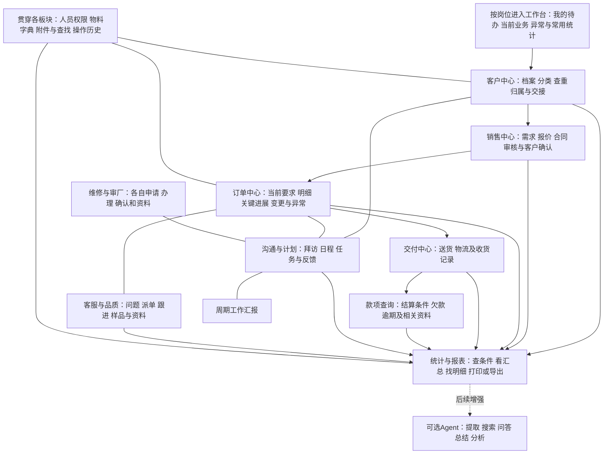

# 基础版功能总图与使用说明

2026-10-27；revision 4；supersedes r3：链接首批一页范围及同一场景跨页面对照，补任务发布／责任变更边界，完整19P保留；前稿项目外保全。proposed／候选设计，非正式开发或产品验收。

## 1. 这套软件先把什么事情办好

员工用普通页面登记和办理业务；主管能安排、核对和跟进；老板按权限直接查客户、订单、进度、问题和统计。即使关闭大模型、OCR和语音模型，这些基础操作仍有入口。未来Agent帮助输入、找资料、解释和分析，使用相同业务记录及权限。

旧功能完整登记，分批实现；不是先照菜单做一堆空页面。每批应当能完成一件具体工作，例如建客户后能找到并交给负责人，或办理订单后能查对应交付和统计。各批都包含所需的查询、附件、权限及输出，不把统计统一拖到最后。

## 2. 功能总图：先看业务，再看技术

图中箭头是候选业务联系，不是已验证的旧数据库外键，也不表示每单都必须经过每个步骤。客户可先有沟通而没有订单；任务、维修、审厂、知识资料可以独立存在。签收、对账、发票、到账与核销不合并成一个“已完成”。

## 3. 各板块有什么输入，能得到什么结果

| 板块及范围 | 员工/有权人员输入或办理 | 系统不用AI完成的结果 | 当前依据及边界 |
| --- | --- | --- | --- |
| 客户 B01—07 | 客户资料、联系人、类别和归属；查重、规划、分配/交接申请 | 可查客户档案及阶段、待跟进/待分配清单、归属历史 | 旧表单/列表/公海配置；附近客户、盘点等仅菜单，具体办理待补 |
| 销售与目标 B08/B11 | 需求、报价条件及版本、审核、客户确认、订单信息、目标规划 | 可查报价/合同/订单及当前适用版本，按已定条件出清单和目标结果 | 主管图及报价资料；不能只凭旧合同列表确认完整录入/落单规则 |
| 当前订单 N01 | 明细、交期、关键节点反馈、异常、重要变更及依据 | 显示已确认进展、待核反馈、缺更新和处理责任，保留变化历史 | 用户已选混合分工；节点、完成依据、确认资格和时效待核 |
| 交付和款项 B09/B10 | 送货相关记录与依据；查看结算、收款相关资料并跟进 | 分清计划/实际发出/收货，按明确账期查欠款和逾期 | 送货/欠款页及主管图；应收来源、核销和收款办理深度未定，不扩成完整财务 |
| 协同和汇报 B12—15/B19/B21/N02 | 拜访、日程、任务、通知、讨论、适用审批和工作总结 | 按人/客户/日期查记录，找待办/反馈/决定及汇报；时限明确后可自动提醒 | 普通任务可独立；不以发送当已读，不以审批当执行或验收完成 |
| 客服和品质 B16/B17/B34 | 问题、图片等依据，派单、措施、跟进、验证/处理结果、样品申请 | 查问题进展、待处理及适用超时清单，关联订单或独立问题资料 | 旧菜单/空页、公司品质资料；超时和关闭规则待核，不能把加工完成当检验合格 |
| 组织与配置 B22—28 | 人员、部门、角色、业务员、物料、单位、客户及业务字典 | 相应人员按获准范围办理与查看，历史归属/字典引用可解释 | 已见组织与部分新增表单；完整权限矩阵、自定义表单深度未展开 |
| 统计报表 B29—36 | 选期间、范围、分组和指标，查看/打印/导出 | 固定规则计算、图表和明细；同条件输出结果一致、缺数据明确提示 | 有实际统计/对比/预览；不反推未知公式，不把虚拟打印选项当通用数据导出已验证 |
| 维修审厂 B18/B20 | 报修/维修/确认，审厂申请/审批/评审资料/确认 | 各自记录、待办、处理结果及查询 | 目前仅菜单；保留迁移范围，待实际字段和流程再定深度 |

附件保存、普通搜索与查看(N03)、公司内外访问及易查数据(N04)贯穿上表。基础搜索覆盖编号、名称和已有可读文字；不调用识别模型时，不承诺未转写音视频及新扫描图片可按其内文搜索。

报价和订单页面需要体现隆实自己的材料/加工业务，不能只套通用客户软件：

- 钢材、外协、模胚按实际场景分流；材料牌号、形状、加工项目、公差、数量/单位、交期和图纸分别核。
- 客户要求的净尺寸、报价采用的计价/计重尺寸、采购下料尺寸与加工余量用途不同，不能只留一个“规格”后自动套用。
- 单件/总量、估算成本/实际成本、成本/售价及适用报价条件分别记录。未核有效价格、换算、税费或精度前，不套一条通用公式声称都能算。
- 客户确认后的内部/供应商下单及PMC安排留相应依据；进展与检验再接具体明细/范围。记录这些交接不自动决定新做完整采购或库存系统。

上述区别有主管流程和已读部门材料支持，正式字段、必需项和适用规则仍待收敛；不是每类业务都强制填全套字段。

## 4. 页面怎样组织，减少到处翻找

建议主导航为：**工作台、客户、销售与订单、交付与款项、协同、客服、统计、资料、管理**。这是候选分组，旧功能可合并入口，不能因此丢能力。维修、审厂在管理/协同中有明确入口，不隐藏为“以后再说”。

客户、订单、任务采用“列表找对象→详情看关联→相应页面办理”的共同方式。老板可从统计查其获准的相关记录；员工从待办回到原事项，按需关联客户、订单、设备或独立资料，不必抄一份资料到多个页面，也不强制独立事项先有订单。

| 页面组 | 页面中主要看什么/做什么 | 对应功能 |
| --- | --- | --- |
| P01 工作台 | 按当前账号权限列待办、当前业务、异常/缺更新和常用统计；不替每人默认展示全公司经营数 | B35、N01/N02/N04 |
| P02 客户列表/档案/建档 | 阶段、客户资料与负责人；普通搜索、查重、新建、查看相关报价订单、沟通和附件 | B01—03、N03 |
| P03 客户经营与交接 | 公海配置/分配/抢客审批、异常客户、离职继承、盘点及附近客户待补入口 | B04—07 |
| P04 报价/合同及办理 | 列表、条件与版本、录入/修改、送审、处理结果、客户接受登记、传单及落单衔接；已补候选办理区，具体规则待核 | B08；N02适用审批 |
| P05 订单详情/进展/变更 | 当前要求、明细、内部/供应商下单安排及依据、已确认和待核反馈、异常、下一步、交付及相关事项 | N01、B08/B09/B16、N03 |
| P06 送货与交付 | 选择可靠订单/明细、送货记录、发出与收货状态、分批剩余和异常 | B09 |
| P07 款项与跟进 | 按客户/期间查欠款、账期和逾期，查相关对账/收款资料与跟进 | B10、B32部分；不等于全套账务办理 |
| P08 任务/日程/通知/审批 | 独立或关联客户/订单发事项，查看安排、反馈、讨论、审批决定及执行情况 | B13/B14/B21、N02 |
| P09 拜访/外勤/用车 | 拜访记录及计划、两类规划、打卡、用车记录与查询 | B12—15 |
| P10 客服/样品/问题资料 | 服务事项、分派、跟进和处理；样品申请、问题资料及适用时效查询 | B16/B17/B34 |
| P11 周期工作汇报 | 日/周/月/季/年记录；引用业务汇总并写工作说明，保留作者及期间 | B19 |
| P12 统计与输出 | 选条件/分组、看汇总/对比和相应明细、输出结果；缺口与口径说明一起显示 | B29—36 |
| P13 目标规划 | 客户规划、新客次数规划、业务员合同/月目标及适用达成查询 | B06/B11；B14目标深度待核 |
| P14 人员与权限 | 员工/部门/角色/成员、业务员对象、授权和历史归属 | B22—24 |
| P15 物料与业务配置 | 物料/单位、客户级别/区域等字典、业务所需公海与审批配置 | B25—27 |
| P16 维修 | 报修、维修、确认、设备/故障/维修组和查询；已补候选，细分表单／资格仍待核 | B18 |
| P17 审厂 | 申请、审批、评审资料、确认；已补候选，对象／标准／资格仍待核 | B20 |
| P18 我的与系统设置 | 个人资料、密码/显示/退出；菜单、表单/模块/系统等扩展配置另定深度 | B28 |
| P19 资料 | 文字、文件/文件夹、附件的保存、标注、普通查找和按权查看；可回所属业务 | N03 |

可视草图见[基础版关键页面草图](../页面与原型/基础版关键页面草图.html)：r8包含总览、目录及P01—P19全部候选操作布局。已能讨论每组入口、输入与结果；盘点／附近客户等细分办理、公司规则和完整规格仍未齐，不能据19组布局声称所有功能设计完成。图内数据全部虚构，业务按钮仅示意。

草图目前可做本地文件检查；内置浏览器安全策略不允许直接打开该本地HTML，本轮未完成浏览器视觉或点击验证，不冒称页面已实测可用。

## 5. 一件事怎样不靠AI办完

以下是**合成纸面操作例子**，不是公司流程验证或已运行的系统：

1. 员工建“示例客户甲”，录入已知联系人及要求；客户查重有候选时人工核对，不自动合并。
2. 人工填写报价需求：示例物料、2件、交期及条件。按已核规则计算/填写金额，送适用审核。审核通过、向客户报价、客户接受分别留记录。
3. 有权人员依据客户确认建立/接续示例订单O-DEMO-001，关联适用报价。重复点击、相似客户或未确认报价不能变出第二笔正式订单。
4. 关键岗位补记本次“加工反馈1件”，该反馈先待核；跟单查漏。老板可以看到“有反馈待核”，不能因此看到整单完成或可出货。
5. 有权人员按明确规则确认有效进展，送货登记选择本次明细及数量。计划发货、实际发出、客户收货分别记录；分批不把剩余量清零。
6. 主管/老板通过普通列表及详情查看；统计按选定记录和日期规则自动汇总，点击进入对应明细。打印/导出带相同条件，且只含获准内容。

稿中“有权”“适用规则”不是已定岗位制度。详细数据关系、审批条件、计价和权限定稿前须补证；目前可画候选页面，不以示例放行真实办理。

## 6. 自动化和AI分工必须分清

| 普通业务系统应做的自动化 | 后续AI可帮助的事情 |
| --- | --- |
| 按已核价格、单位、精度等规则计算金额；按明确口径汇总、对比、排名 | 从截图/语音/文本提出字段草稿，帮助人填写 |
| 按适用规则检查必填、权限、重复、审批条件及单据状态 | 理解口头问法，找到候选资料，提示需要补充的内容 |
| 按已定时限筛待办、逾期和未更新事项，并记录通知过程 | 起草任务或总结，解释获准统计和原因线索 |
| 固定条件查询、报表、打印/导出、历史记录和备份恢复 | 按用户要求组织展示；正式数字仍来自业务服务 |

利润需求和算法仍未确认，不因专家举例加入首批功能。报价成本、估算成本、实际成本、售价与回款不能互相代替。

## 7. 下一层图纸需要补什么

| 缺口 | 当前可推进 | 何时必须有答案 |
| --- | --- | --- |
| 报价/合同/订单关系、计价与审核条件 | 先用已读主管/报价资料拆开动作与候选页面，不重问整个流程 | 对应录入、计算及生效规则定稿/正式开发前 |
| 明细/工序/批次、进展完成和变更影响 | 先画当前要求、反馈、待核/有效结果分区和部分完成示例 | 相应进度/交付模型与确认规则定稿前 |
| 欠款来源、账期、收款/核销深度 | 先保留查询、资料和跟进入口，查既有财务材料 | 款项金额/逾期计算与办理范围定稿前 |
| 当前账号动作/数据/成本/附件权限 | 先画按岗位入口及拒绝越权的预期 | 开放真实资料、搜索/输出和正式操作前 |
| 维修/审厂/盘点/附近/扩展配置的内页 | 保留对应入口与责任，继续找既有表单与用途 | 对应批次设计定稿前；不阻断其余有依据的研究 |

先查已有材料；本阶段按用户要求暂缺项集中留存、不再新增问题或问卷，待用户安排一起核实。技术比较与有限实验按已有证据复用，真实组件缺口才补开源调查；本稿不新定技术栈。

分批建议及覆盖/验收见[基础版分批开发与验收表](../施工与验收/基础版分批开发与验收表.md)。当前“可审阅设计”不等于业务规则已核完、首批已批准或软件已能使用。

## 8. 本段核对记录

2号根据BC01—12/变更分批依据，回读r1第3/5节和HTML P04—P06；3号回读r1第4节P08—P19及HTML P08/目录；4号回读批次表r1全文和HTML P12算例。回执575/577/576仅覆盖这些指定文本，建议合入本套r2，不称三方各审全文或r2整稿独立通过。

三份新专题复用已读材料，本段未重新OCR/遍看原图或运行产品。协调者做文件结构、页面锚点及B/N/A覆盖检查；HTML无外部资源/脚本，业务按钮不执行。浏览器本地预览被策略阻止，未以其他浏览器、服务器或渲染命令绕过；因此未作视觉/点击验证。详细版本/指纹和检查记录在项目外，私有报告不随公开稿转出。

## 9. 本轮收拢：范围有图，规则仍按证据分层

原2号完成[拜访与目标管理](../业务流程与权限/拜访与目标管理设计.md)r1；3号完成[工作汇报与行政事项](../业务流程与权限/工作汇报与行政事项设计.md)r1；4号完成[基础配置与资料管理](../业务流程与权限/基础配置与资料管理设计.md)r1。1号读完三稿，结合旧清单汇成八组新增布局。专题分别复用既有摘要／报告，未重新遍看原图；其固定例子是纸面预期。

| 已补的用户操作 | 与其他板块如何关联 | 不能自动认定的结果 |
| --- | --- | --- |
| 拜访排期、实际沟通、外勤和用车 | 可靠时引用客户／任务；实际与计划各有时间 | 改期不算拜访完成，用车申请不算已使用 |
| 目标与周期工作汇报 | 引用同一实际记录及版本，不重新创建销售或完成量 | 改目标不改历史；提交日报不新增业绩 |
| 维修与审厂 | 可独立存在，需要时才关联设备／对象／工作和资料 | 反馈已调整不等可复工，补交材料不等审厂通过 |
| 物料、配置、设置和资料 | 各业务引用稳定条目／原件版本；按当前权查回 | 改单位不重算旧单，提取失败不丢原件，个人字号不增权限 |

**现在做到：**36组旧功能与新增方向保留去向，19组均有候选布局；首节点五组入口、紧接报价及完整范围可对照。完成的是资料复用、设计和静态结构／文字检查，未验证目标机器操作、员工负担、权限执行、业务计算或产品恢复。

**接着收敛的顺序：**先按已选首节点审一遍“输入→处理→结果→找回”的固定场景，列清必须定稿与可后补的规则；再把首节点所需的界面、数据职责、维护承接和未来验收收成可批准的开发包。未知继续集中，正式业务开发前须具备相应规则及明确范围授权。其余旧功能按逻辑批次保留，不要求先把所有低证据菜单全部展开才讨论首节点。

当前最影响定稿的是相应进展确认／更正依据、动作及数据权限、维护承接；重量舍入阻塞紧接自动计价，不阻塞首节点候选。不能以临时默认值把未知标成已解决。工期是既有低置信预算，不因补了页面减少或变为承诺。

### 当前首节点收敛表：不用等全部远期模块定完

| 员工／老板要办成的事 | 已有候选依据 | 当前完成程度与定稿门槛 |
| --- | --- | --- |
| 找到正在跟的单，知道谁接着处理 | 首节点P01／P05／P12、可靠对象及缺历史分支 | 有固定两单示例；真实订单／明细标识和当前读取范围仍须明确 |
| 关键岗位补本次变化，跟单查漏 | 首节点P05、W08／W09、G04 | 待核、确认、更正与历史已区分；正式生效资格及完成依据未核，不以“收到”代确认 |
| 老板派事、员工反馈，无订单也可办理 | 首节点P08、W10及通知回执分层 | 独立事项和有据期限可表达；类别、当前动作权和适用完成／验收条件待核，不一律新增主管复点 |
| 原件先留住，再人工整理／按权找回 | 首节点P19、W11和完整P19的失败分支 | 已有原件／提取失败人工路径、部分成功预期；真实保管权、按类别上报及保存结果需实现后验证 |
| 同一条件查清单、看原依据并输出 | 首节点P12、W12／W13及G05 | 两单一行一单的明确合成清单；公司选定字段、可见范围、时点及输出产物须定，不先要求全部经营公式 |
| 公司内外能进入、数据有承接者 | W01／W14—16及G03／G06 | 用户使用方向已定，维护方未定；身份、目标设备／网络、异常保存和完整恢复仍需对应方案与验证 |

这张表是现有图纸的收敛索引，没有新问卷，也没有批准开发。不同动作的门槛各自判断：可以先保存待核反馈，不代表已经允许它改变正式结果；已知条件的任务清单可讨论，不必等自动报价舍入或全部维修／审厂规则齐全。

本轮原2／3／4号仅读各自负责的新八组页面区段源文字，未见与其专题的实质冲突；并非三方全文审阅。1号检查21区段／19P、禁用业务按钮、链接与原11业务页保持，36B／16T／4X不丢。没有浏览器视觉、点击、业务运行或公司现场验证。

首节点上述三类操作已对应补入[16项任务包r5第9节](../施工与验收/首批开发任务包与规则依据.md)：进展／更正、任务反馈、资料保管各有输入、结果、失败路径和正式动作停止点。仍为未来施工候选，原16W不变；不是新的开发授权。

## 10. 当前首批审阅入口

先读[首批范围开头一页](首批试用范围讨论稿.md)：五件连起来的事、紧接／后续范围、逐项定稿条件。再读[验证卡第0节跨页面对照](../施工与验收/首批代表场景与验证卡.md)，核更正前后、旧视图、改期、独立事项／资料与输出引用是否说同一事实；[任务包第9节](../施工与验收/首批开发任务包与规则依据.md)是相应操作交接规格。

本轮收拢发现并修正任务的两处隐含前提：仅存草稿不自动发布／通知；转交／取消待处理时不先改当前责任、期限或实际状态。按该类规则允许一次直接办理，不固定增加审批。首节点HTML原固定初始场景和完整19P草图保持原字节，新增分支仍是文字规格，尚未表现为可操作软件。

当前进度是**候选范围与纸面检查已能集中审阅，正式规则／维护与产品验证仍未齐**。既有借鉴及有限实验沿原版本使用，不把本轮文字互审当作公司样本、技术选型或真实试用验收。暂缺仍集中，不新发问卷。
