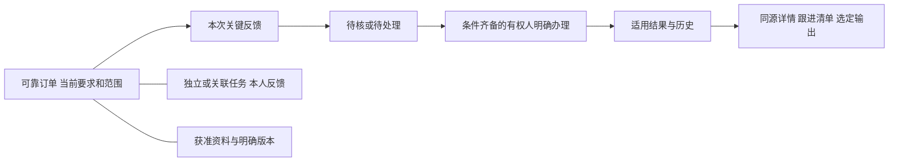

## 最新局部证据与新业务来源

[跟进准备任务草稿实测](../../AI调研/技术验证/2026-10-29-跟进准备任务草稿与跨账号迟回实测.md)已补普通打开不写、明确保存／下发／反馈／读回及当前源读权、局部失败和迟回证据；历史“任务桥尚未实施”不覆盖本段。仍未完成正式结果办理、日排单和同源实际产物，不勾W整包或正式试用。

[运营获客交接](../../AI调研/产品经理调研/2026-10-29-运营获客与线索分配-需求补证.md)补完整客户上游：留来源、分配、接手反馈、报价订单保来源；[物流条件](../../AI调研/产品经理调研/2026-10-29-物流回传与收款放行-需求补证.md)补交付后半程。两段尚无后台运行，不拉入原在途首批已批范围。

# 首批业务方案与订单工作单

2026-10-29 · 候选方案第7版；supersedes r6（r6原字节存task-bridge-docs-before）；以下前版：supersedes r5（r5原字节保留项目外logistics-and-binary-before/），本版回填图片PDF有限实测并补物流／回款条件来源；以下原修订保留：supersedes r4（r4原字节保存在项目外pilot-checklist/main-plan-r4-before-pilot.md），本版补最小试用候选入口；以下历史修订保留：supersedes r3，r3原字节保存在项目外continuous-business-plan-20261029/dispatch-design/main-plan-r3-before-operation.md。本版链接具体排单操作／异常／输出和开源比较；此前版本分别保留项目外，旧限定回读范围见末节。按公司已有资料和已选顺序收拢，供业务方向审阅和后续施工使用。**顺序已选，具体细则和正式开用仍需对应依据；当前不是已经交付的员工软件。**

## 先看这一页

**首批先解决一件工作：员工找到一张正在进行的订单，少量补记关键变化；相关人接着办，老板能看清已有依据、待处理和下一步。**

一张单主要回答五件事：

| 打开后想知道什么 | 方案准备显示什么 |
| --- | --- |
| 这是什么单，客户要什么 | 可靠订单／客户线索、当前适用要求、已知明细和工作范围；不明处如实留出 |
| 现在谁在处理 | 有依据的当前责任、相关事项和待接手范围；登记人不自动成为负责人 |
| 目前知道做到哪里 | 按具体范围显示有据结果、待核反馈、缺更新；不把一条消息换成全单百分比 |
| 卡在哪里、还差什么 | 重要变更、未决问题、缺依据及其下一步，不以空白代替已完成 |
| 接下来谁办、依据在哪 | 相关任务／期限或未知、反馈和获准资料的指定版本；看完能回原位置 |

员工尽量只补本次关键需求、重要变更和任务反馈；可从可靠上下文带出的不再重填。不要求把每条微信、每次聊天都归档。任务和资料仍可独立保存，不强迫先造订单。

**这批先把人工基础路径做好，AI后续增强。** 新需求／报价／新订单紧接着安排；送货款项、客户经营、品质／样品、汇报行政、维修审厂、组织配置和旧统计等完整范围继续保留，并非只开发这五个问题。

目前有虚构小样能演示部分订单登记／文字跟进、单接收人任务下发／本人回复、文字与小txt及小型PNG/JPG/PDF保管和固定版资料查看。图片/PDF有限证据、失败修正及离线补证见[实测](../../AI调研/技术验证/2026-10-29-截图与PDF保管及指定版查看实测.md)，不代全格式或整版验收。**正式明细进展、真实岗位授权、完整报表、公司内外实际使用和EXE尚未完成。**

用户只看目标、当前结果与范围取舍；助手承担资料核对和设计检查，实际岗位规则由相应负责人核。此页不要求新实习生逐字段或逐按钮验收。

## 1. 同一张工作单怎样组织

上部是“这张单的当前要求和责任”；中部按明细／工作范围看进展和重要变化；下部是跟进、任务和资料。相关资料采用局部只读查看，原页未提交输入保留。宽窄屏布局属于后续界面验证，本稿只确定信息和动作含义。

箭头表示信息和工作联系，不新增每条都要主管审批的制度。一般备注只保存记录；规则／资格齐备者可一次明确办理适用结果。任务回复、资料上传和正式进展分别留结果，不互相冒充。

### 工作单最少需要的信息及来源

| 信息组 | 优先从哪里来 | 员工本次需要做什么 | 缺少时怎样继续 |
| --- | --- | --- | --- |
| 订单身份和当前要求 | 获准原单／可靠接续资料／已确认的当前要求 | 核本次对象和重要差异 | 无需补全旧报价史；不能可靠对单的资料先独立留存 |
| 明细及本次范围 | 原明细、内部／外协／交付的可靠分配关系及有据来源 | 只选本次涉及范围，不重抄整单 | 可留整单说明或待关联反馈，数字不落到猜测的默认行 |
| 已知交期、责任和有效结果 | 各自当前适用记录，不从最新聊天或附件名推定 | 看本次变化是否只是请求／反馈 | 期限未明不判逾期，范围覆盖不足不算全单进度 |
| 本次反馈和来源 | 本人补记／原话／已有资料中的可用内容及定位 | 简短写本次关键变化；已知发生时间才填 | 保留发生时间未知及登记时间，不把文件日期当现场时间 |
| 任务／下一步 | 已生效当前责任、发布内容版、实际回复及适用期限 | 明确任务内容、适用接收人；回复本次进展 | 草稿不进对方正式待办；待转交不先换当前责任 |
| 原件／文字资料 | 保管身份、内容版本和可靠引用 | 选获准资料的具体版或先独立保存 | 提取失败可走人工；失去原件权不借任务或旧链接打开 |
| 读取／办理状态 | 服务实际保存、原操作及本次查询结果 | 结果未明先查这次原操作 | 不换键盲重办；失败不报0条，历史回执不复活旧业务值 |

这是信息来源约束，不是要求员工每次填七套表，也不是已定必填字段全集或数据库结构。账号、当前责任、业务员归属和历史作者各有含义。

## 2. 员工、跟单和老板分别怎样使用

**员工处理事情时：**从本人获准的订单或任务进入，先看对象和要求，补本次关键变化或回复；有可靠资料可选择引用，没有附件也能留文字。只有任务必要说明权的人照样可在任务里办理，不要求先开整单。

**跟单协调时：**看已有结果和待处理内容，追到原反馈、要求版本或各岗位交接依据；分清“收到通知、实际下单、本次安排、现场反馈”。客户换负责人、任务转交、订单接办各按适用范围生效，不自动改历史归因。

**老板查看时：**从普通跟进清单进入同一张单，看到有据情况、缺口和下一步；重要金额／进度必须追得到来源及采用条件。每个人看到其获准范围，不用AI也能查询，输出与明细按同条件对账。

以后接AI时，AI帮助提取、查询和解释获准内容；业务系统负责规则、权限及正式结果，不让模型替人确认加工完成、改交期或销账。

## 3. 用原固定例子走通目标表现

以下完全沿[原验证卡第0节](../施工与验收/首批代表场景与验证卡.md)的虚构时点2030-05-08 10:00。**这是将来的目标表现，不是当前网站或今天公司真实订单。** 原输入、资格和规则不被本稿改写。

| 同一组对象／动作 | 工作单和清单应怎样显示 | 不能出现什么 |
| --- | --- | --- |
| 甲单需求10件；仅范围甲加工4件有确认；“原4应3”反馈尚未正式办 | 当前局部仍4，更正待处理；全单累计、交期及发生时间未知，登记09:20；下一步A核本次更正、期限未定 | 全单40%、剩6件、保存反馈就变3或加成7 |
| 在单独预给资格和规则齐备的分支，有权者明确更正成功 | 适用局部结果3，原4及替代依据保留；其他全单未知仍未知，任务验收另算 | 删除原4、把真实返工当录错更正、自动完成整单或任务 |
| 乙单有效交期05-10，客户要求05-09待处理；相关事项期限09:00且例中给定未完 | 有效05-10与待处理05-09并列；事项过期未完可见，下一步B核变更影响 | 因事项过期就判订单延误，未获加工更新就判未开工 |
| 丙是独立事项，回复“已联系，等对方答复” | 原事项有本次回复，按例仍未完成；不进入订单计数 | 回复即验收完成，或为了存事项新增第三张订单 |
| 丁是独立文字，已保管但未可靠关联，按例尚未上报 | 在本人获准资料入口找回，状态分别说明 | 自动造订单、自动上报或声称已通知老板 |

同条件获准订单清单仍是2行；事项、资料、多个范围都不加出订单数。甲的局部更正、乙的改期请求、丙丁独立状态不能被一个“已处理”字段吞掉。历史研究适配器名为pending_feedback的字段中还可能返回state=applied；新清单须按有据动作状态分清历史反馈和当前待办，不按字段非空重复派已办事项。这是施工接缝，未在本轮修复或验证完整待核队列。

### 主要失败和变化怎样处理

- 原操作提交后没收到回复：保留原内容／身份，先核这次结果；一次查不到不证明没办。合法同次原内容只返回原结果，改变内容／对象／所见版是另一类冲突。
- 切账号、换目标或旧回复迟到：旧内容不能回填新上下文；来源不明或失去相应权时，受影响块停在相应状态，不转存别单。
- 某块读取失败：标该块暂不可用，不当合法空，也不无故抹仍获准的任务正文／已保存结果。
- 同名资料补交v2：旧关系仍指v1，查看明确版本；当前整理标题与当时字节版分别标识。目标正常升版不应让仍获准的旧引用消失。
- 未提交输入：普通查看尽量在原页只读，保留原稿；真正切换／放弃须明确，已提交待查不按可放弃草稿处理。刷新／关页持久草稿没有完整实现，不作承诺。

## 4. 老板第一张跟进清单

沿原首批五件事，先用**一行一单**显示：可靠识别、当前有据情况／覆盖、待处理／缺口、适用交期、下一步／责任及本次读取时点。它是业务跟进清单，不增加未确认的经营金额或利润指标。

筛选、当前权限、数据时点和字段性质相同，详情／清单／选定产物才可对账。当前页与全匹配范围分别说明，缺更新／未知／合法0和读取失败分开。输出选一种明确目标后做实际产物核对，旧合成CSV不代替完整新业务报表。

合同／销售／拜访／客户／目标／客服等旧固定统计继续按B29—B36和原批次建设；有明确主题时随业务早接，不一律拖到最后。日报／月报／利润此前只是举例，不擅自变成已定首批指标。无模型仍应能按已核规则统计和输出。

## 4.1 新资料补齐：未出货核对与每日排单

**完整基础功能明确包含PMC每天核对未出货、按车次安排出货、业务补漏和执行跟进。** 此前交付板块有归属，但这条工作尚未细化充分；当前小样没有排单、司机／车次或未排池，不把它当已实现。

按[新PMC需求补证](../../AI调研/产品经理调研/2026-10-29-PMC未出货跟进与每日出货排单-需求补证.md)组织：待安排范围→人工编排当日／车次→对应业务核对补漏→保留改排版本→记录实际发出→再接收货及后续交接。支持日常查询及选定范围的打印／导出作为基础候选能力，不依赖AI。

订单工作单展示本单相关排单与实际情况；PMC的日排单则允许一车多单、同单按范围分次安排。业务只补关键差异，不重复抄表。原料供应与加工供应的件数不相加；送加工不算客户交付；计划时间、实际发出和收货分开。原群通知、表颜色、分组与备注不一致时保留来源待核，不选一列猜全单状态。

未出货不等于未排：有些单可能已排好只等实际执行，有些尚待安排，还有些缺最新反馈。候选清单分开表达，避免把未出货全数重复排车；具体状态／筛选仍按岗位依据落实，不据截图定死。

日排单是明确保留的业务成果，需在施工安排中单列，不用“能写跟进”替代。具体首批做到哪层继续据此收拢，原受审r12不改写为已批准新排单细则；公司实际确认、权限及输出规则仍集中待核。完整原件仅在受控资料目录，本稿不含真实业务行。

### 本段继续：排单怎样实际办，采用什么思路

已补[每日出货排单与未出货跟进操作稿r2](../页面与原型/每日出货排单与未出货跟进操作稿.md)：三个入口共用订单／范围，表格按日期车次组织；草稿、明确采用、业务补漏、范围改排、实际发出和选定输出各有结果。独立纸面例戊展开已发两件只改未发两件、送加工不计客户交付、未知分批重量不抄整单重量，以及冲突／超时续办。这些是设计预期，不是新界面运行。

操作稿r2已采纳2／3号指出的“缺已发记录≠未发可改”，采用时须核相应当前实际而非只看安排版；加已排／实际变动交叉例。并据4号把同一纸面例的订单／项／车次及分用途件数接到产物，首段业务核对结果与一种基本输出不拖后。此为设计修正，无新运行。

只读[开源思路比较](../../AI调研/技术调研/2026-10-29-出货排单开源思路比较.md)查了车次与仓储分批两类路径：取车次聚合、范围和防重复的设计；不把采用日排单变成库存过账，也不照搬仓库拣货／Alpha planner。源码快照和元数据留项目外，无新安装、技术栈选择或业务源码复制。具体首批深度继续收拢，但每日排单已经明确作为基础工作成果保留。

### 物流与回款条件的新资料增量

[新增5图补证r2](../../AI调研/产品经理调研/2026-10-29-物流回传与收款放行-需求补证.md)明确物流回传、业务核对／催收、适用付款条件与送货／通知自提联动。物流情况、当前条件、可办理动作与沟通各留有据状态；不一律先款后货，不把已到当签收或旧回复当新条件满足。原款项／物流功能归属保留，具体首批深度未借截图自动批准，当前后台尚未实现。

## 5. 哪些有证据，哪些还要施工

| 工作结果 | 已有实际证据可以复用 | 当前不能算完成的部分 |
| --- | --- | --- |
| 找同一张单、留一次关键变化 | 虚构基本登记、整单文字跟进、同次查回和普通清单 | 正式明细／范围、基线确认、数量性质及公司当前规则贯通 |
| 派事与本人回复 | 单接收人草稿／明确发布／本人反馈／发起人读回 | 从源跟进一键开草稿尚未做；多人、转交、取消、通知／审批／验收未完整实现 |
| 保存并引用资料 | 人工文字／小txt、合成PNG/JPG及两页PDF、分类标签、具体版引用、订单／任务内只读返回 | 更多格式／音视频／目录、大文件、完整上报及细粒度真实权限；本轮仅对新合成PDF增加测试只读资格，复合普通UI有有限证据 |
| 有据进展与选定输出 | 早期固定HTTP局部更正、原操作和CSV实验有有限证据 | 当前普通界面没有完整正式进展／更正及同源产物链，不能拼接几轮实验称产品已通过 |
| 员工长期实际使用 | 有运行／恢复／交接候选和局部组件实测 | 无正式安装包／公司内外目标环境／同版完整恢复与具名维护接手验收 |

本段仅收拢图纸与纸面对照，没有新业务运行或真实资料处理。实测条件、失败和版本以各原报告为准。

## 6. 后续按工作成果施工和验收

仍使用原W01—W16、K1—K8及T/X，不重排原编号。下面是候选施工组合，不是已下发编码或承诺工期。

| 顺序／工作成果 | 复用任务 | 形成什么可检查结果 | 进入后续要满足什么 |
| --- | --- | --- | --- |
| 先固定工作单与当前权 | W01/W02/W07/W14 | 对象／范围／角色测试资格、字段来源、成功／未明／拒绝的固定例一致 | 真实开放另核G03；合成资格不代真实制度 |
| 接续、补记及明细跟进 | W07/W08/W09及W11必要片段 | 已知内容只补一次，反馈／变化和适用结果分层，重开同一对象 | 正式数量／更正依G04及当前动作权，缺依据不放行，普通留存继续 |
| 接上任务和指定版资料 | W10/W11/W14 | 从可靠源开草稿、明确发布／回复、读对应版并回原位置；独立事项仍能办 | 无暗中发布／上传／开放整件；跨页新稿和待查均有实际检查 |
| 交老板清单及一种输出 | W12/W13及对应业务 | 固定条件清单、明细、实际产物同源可对账 | G05对应本主题／字段／范围明确；不等全套利润算法 |
| 做真实试用前的交付核验 | W15/W16贯穿、此处综合联验 | 同一发行物在目标入口、当前权及成套恢复后能继续所选工作，接手人离开作者能按说明操作 | 公司有权者批准相应真实数据／入口／部署，G06承接及环境条件落实 |

当前不能把本机临时网址当公司内外入口，或把项目外工具箱当员工安装包。维护不默认由实习生或AI承担。历史投入估算仅按[原量级假设](../决策与变更/2026-10-27-首批投入量级与维护安排.md)参考；本段未重测工期，不按四个窗口换算人周或扣除演示数量估出剩余天数。

### 只限制相应动作的待核项

| 依据尚缺什么 | 限制什么 | 仍能继续什么 |
| --- | --- | --- |
| 实际对象／范围、确认与更正依据（含G04） | 正式基线、确认／更正和全单结论 | 来源研究、待核反馈、只读已有结果及候选设计 |
| 实际对象／字段／动作授权（G03） | 对应真实开放和办理 | 明确虚构资格的例子、拒绝分支和图纸核对 |
| 本张清单的条件／覆盖／产物（G05） | 该主题正式统计和输出验收 | 收拢来源及固定例，不造新经营算法 |
| 维护／位置／资源与真实接手（G06） | 可信工期／运行保障及正式投用 | 比较同范围承接、交付要求和已有有限证据 |
| 报价重量舍入等（G01） | 紧接的正式自动计价 | 当前在途／任务／资料图纸，不重新问已答报价模式 |

这些不是给用户的新问卷；助手先查资料，按用户安排集中核实，必要时只找实际负责者核影响当前定稿的具体点。

## 6.1 最小可试用范围的收拢入口

[首批最小可试用清单r2](../施工与验收/首批最小可试用清单.md)把本稿分成六项交付候选：找单接续、关键变化与所选正式办理、派事反馈、常见截图／PDF人工资料、PMC人工日排单、同源查询及首个输出。新增排单和格式是推荐深度，不改原首批r12为已批。原txt小样不能代图片／PDF；旧HTTP不能代普通入口正式进展。首个产物具体推荐日排单PDF，老板跟进本候选先系统内查询，其输出不被这张PDF替代。

清单把开发前准备基线、获准实现后的同版验收、真实员工试用分开，不能等所有长期维护条件到齐才设计，也不在缺相应规则／资源／支持责任时开放真实试用。下一张截图／PDF项目外虚构执行卡已具体化，尚未启动；不凭本段扩大为正式业务开发或真实资料访问。

## 7. 依据、追踪和此次边界

主依据：[一页业务用途](一页看懂-谁用系统办什么事.md)、[完整迁移清单](基础功能迁移清单.md)、[覆盖与J-01/J-02](岗位工作覆盖核对与下一批重点.md)、[受审首批r12](首批试用范围讨论稿.md)、[原固定卡r4](../施工与验收/首批代表场景与验证卡.md)、[数据r9](../数据与接口/报价与进度关键数据及办理边界.md)、[权限r1](../业务流程与权限/首批权限与授权候选.md)、[原操作稿](../页面与原型/订单详情与人工跟进操作稿.md)及[任务包](../施工与验收/首批开发任务包与规则依据.md)。

本版复用原2号业务核对r2§2—5／8、3号动作与结果r2§3—6.1、4号施工与投用门槛r2§3—6；三方新图段当时仅据1号转述，未把它们当原图独立核验。新图事实以1号本次需求补证的阅读范围为限，当时尚待三方对该补证回读，后续情况见下段。本文的“应该显示”“将来验收”不是实际公司制度／产品运行结果；原受审文件与16W原行保持，不凭连续指令扩大正式开发、真实资料、生产、安装、Git推送或关机范围。

后续已收2／3／4回读910—912：均实际读需求补证r1，分别核主稿页首／§4.1、§3／4.1、§3—4，所读主题未报实质错接；2号补未出货与未排不混同，已在§4.1采纳。不是主稿全篇／原件独立复核；主稿后续本条及采纳文字不声称已再次全审。三方专题最新r3，回读及hash记项目外工作段，设计完成不等岗位／产品通过。
