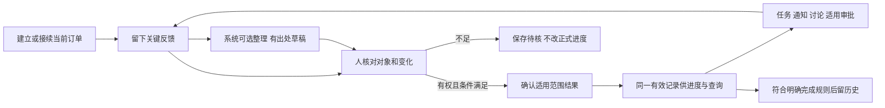

> 2026-10-27最新范围调整：本稿保留为在途反馈场景的局部操作/验收草案，不是完整基础功能范围。 先读[基础功能迁移清单](../需求与范围/基础功能迁移清单.md)。旧版正文保留，不表示已获正式开发批准。

# 在途订单操作与验收草案

2026-10-27；revision 2；supersedes r1：按指定回读细分核对状态、补FB映射和NC证据边界；r1保全项目外。1号汇总；**proposed／可审阅操作图纸**。方向来自用户本轮要求；合并2号操作r1、3号员工反馈r1及4号技术验收r3的指定内容。本文不是已实现界面、公司制度确认或正式开发批准，没有新运行组件。

## 1. 先看这一页

这套系统先帮助公司把正在处理的订单管清楚：**现在要求是什么、已经确认什么、最近有何变化、哪里待处理、由谁跟进。** 完成订单另可查历史和分析，不以资料存得多就自动认定进度准确。

箭头是职责联系。直接人工反馈不必等AI；普通任务和未关联资料仍可独立存在；核对与确认如同人有权且规则允许，可合成一次明确操作，不规定每次必须走多个页面或多轮审批。

本次先给出六组页面职责，未定最终菜单或首批实现数量：

| 页面／区域 | 人能看到和办理什么 | 系统应主动减轻什么负担 |
| --- | --- | --- |
| 当前订单工作台 | 获准订单、需求摘要、已有确认、最近更新时间、待核／异常／事项；按当前与历史用途区分 | 不用翻遍聊天找线索；没有更新明确提示，不造0或“未开工” |
| 订单详情 | 明细与工作范围、需求版本、过程结果、变更、事项、来源历史 | 同一结果供多处引用，不要求另填一份老板汇报表；计划／实际、局部／全单分开 |
| 快速反馈 | 从订单／任务带上下文，选文字／截图／语音等关键内容或简短补记；也可先独立保存 | 不重抄整单，不搬运所有聊天，不强制纯文字补图片；只补本次必要差异 |
| 待核与确认 | 草稿对照来源、必要缺项、关联范围和本次变化；按权核对或确认 | 只呈现与该动作相关的问题；看得清且规则允许时一次办理，不默认老板重复审核 |
| 工作协同 | 派发任务、讨论、反馈、适用审批、验收以及通知实际状态 | 可引用现有进度结果；通知、已读、反馈、批准、执行、验收分别表达 |
| 历史与分析 | 已完记录、需求／结果／更正历史，明确期间和数据截止时点；受控AI问答／按需表图 | 当前与历史不混计；历史当时已知和按现有更正重算分开，结果带口径与依据 |

以上是文本交互设计，既有五张PNG仅作原研究参考，没有声称本轮已改图、按钮可用或手机已联验。

## 2. 正常时怎样少操作

使用全虚构例子：演示订单A某明细需求10件，本次加工范围甲覆盖4件。为说明正常分支，假设对象、数量含义、完成条件及当前动作权均明确；公司真实规则不因例子而成立。

| 步骤 | 操作者最少做什么 | 系统应给出的可检查结果 |
| --- | --- | --- |
| 建立／接续 | 有权者核可辨需求及来源，区分新需求行与旧行；正在做的单可只登记有依据的当前基线 | 系统生成稳定内部身份，来源和版本可追溯；缺过去记录显示“接续前历史未齐”，不造过去节点或从零累计 |
| 留关键反馈 | 从范围甲任务进入，补记“这4件加工完成”或选相关资料；只补必要差异 | 可靠对象／范围带出并保留依据；员工手工预选本身不算关联正确。自由反馈可先保存待核 |
| 可选整理 | 对数字、否定词、所指范围等不清处核实；直接已知的文字可人工办理 | 原文／复述／模型候选分开；能回到获准页、格或时间段。没有原音不造录音，未知不填0 |
| 核对／确认 | 在符合当前权、明确规则和版本的条件下确认本范围结果；没有确认权时只办可办的核对 | 收到业务提交成功才显示结果已确认；仅保存且未核对显示“尚未核对”；已核对但未获正式确认显示“内容已核对，业务结果待确认”，避免让人重复核对。超时显示结果未明并查询原操作 |
| 查看与跟进 | 老板／主管／员工按各自权查看该结果、依据和待处理事项；必要时下任务 | 显示“甲范围4件加工已有确认”及时间；其他范围未获对应更新。品质、出货、任务验收和通知不由这条结果推定 |
| 完成与留档 | 具备明确完成规则与权限后办理适用完成；历史继续可查 | 归档是整理标记，不替代完成决定；暂停／取消不当已完。后续质量事项可关联历史单，不静默删改原结论 |

业务发生、录入、确认和查询数据时点分开保留；时间未知不得由上传时点补造。无需每次都让员工手填这些时间，但展示须说明系统真正知道什么。

## 3. 遇到问题怎样继续

下表为未来验收预期，**不是今天已执行通过的产品测试**。标明“待核”要允许保留工作并给出具体原因，不能只给一个无法继续的通用报错。

| 情景 | 应怎样处理／仍可做什么 | 明确不合格的行为 |
| --- | --- | --- |
| 截图数字看不清，或语音含“还没检验” | 保存来源，必要字段待核，可人工补清或回看相关部分；明确哪一阶段 | 猜4或9、填0，或把否定改成检验完成 |
| 同名客户／同规格多单，或一份资料提到多单 | 保存待关联，分别核获准片段和范围；未关联不推进任何猜中的订单 | 用搜索第一名绑定；让用户看到受限订单候选或因此开放整件混合附件 |
| 同次确认重复点击／重传 | 原操作身份与内容不变时返回既有结果；正文有改动走明确修改路径 | 多记数量，或同键换正文悄悄生效 |
| 两人不同请求又报同一累计4件 | 结合事件依据、范围和数量性质判断补充／新变化；不明则留反馈待核 | 相加成8；反过来凭同数就删掉本来不同工序的真实事件 |
| 反馈“现在6件”但未说含义 | 只补问本次必要的范围／新增或累计含义，没依据先待核 | 自动4+6，或未经核实直接把当前改为6 |
| 原4录错为3，或后来1件返工 | 录错用更正链留原4和当前3；真实返工另留后来事实，适用影响另定 | 旧值与新值加成7；将真实返工伪装录错、删历史或又多记成产品数量 |
| 需求10拟改12，旧反馈或审批晚到 | 请求与现行版本并列，生效核适用权／版本／影响；旧依赖不能无条件沿用 | 客户一句话即改当前目标，或新目标自动增加完成量 |
| 断网未发送，或已发但没收到结果 | 未发则若允许本机保存须标未提交；已发则查原操作，暂查无仍不代表未执行 | 一律写提交失败并让人换键重办；缓存显示成最新正式状态 |
| 旧提取／旧图片晚到 | 留输入及草稿基线、来源时间与差异；不覆盖较新核对或当前事实 | 晚上传便认定现场最新；旧输出把3改回4 |
| 打开后撤权，或只许看进度不许看整件 | 每次适用边界核当前权，已有进度与附件分别判断；拒绝不泄露受限内容 | 凭旧缓存许可、模型自报主体或曾成功的回执绕权 |
| 加工有确认又收到质量风险 | 保留风险原句并在获准范围显著呈现，与现行加工结果并列；紧急事项按适用处置路径继续，通知如实显示状态 | 把待复核当不合格、自动抹加工结果或声称已正式停发／主管已读 |
| 完成、取消、归档和重开 | 保留各自用途及限定范围；重开后当前集合不重复，历史按明确口径选取 | 取消当完成率100%、归档改业务状态、同一单同时在两个当前分母重复累计 |

## 4. 谁负责哪一步，怎样验收

组件是既有条件性候选，不是本轮新选型；原许可证、维护证据和适用版本沿技术专题追溯。部件安装不等业务链已通过。

| 交接 | 主责／可复用部件 | 后续必须能证明的正确／错误表现 | 本轮依据及限制 |
| --- | --- | --- | --- |
| 当前订单与对象范围 | M02业务服务；关系记录候选PostgreSQL，JSON校验候选Pydantic | 插行不改旧明细归属；父范围与子分配不双计；无可靠关联可存反馈但不确认 | 2号O01—06／T01—05；4号T01／04／06／08，均纸面；真实对象对应未联验 |
| 原件保存与草稿 | M03保管、M04处理；tusd续传，原生读取／OCR／音视频按需 | 三件只保存两件须逐件列出；提取失败不丢原件；迟到结果不盖新核对 | 3号FB02—04／09—10；4号T02—03。昨日限定传输/提取可复用，跨存储故障和迟到竞争仍未通过 |
| 确认、防重及更正 | M02在事务内核对象、规则、当前权、版本和操作内容 | 同键重试只一次作用，竞争旧版有冲突，更正留历史；不同键同事实另核 | 3号FB01／05—09；4号T05—07。PG实验只有限定证据，7个安全与2个NC完整表时点未采，原NC错误映射及事后静态r2纠正保留；真实业务防重／权限未验 |
| 协同与通知 | M05显式状态转换；M02结果引用，M08投递对账 | 同一结果可供任务引用；反馈／审批／执行／验收／送达分离，通知重试不再确认业务 | 3号FB01／12、4号T11—12及既有状态机制比较；人工路由与可靠投递尚未运行 |
| 当前／历史取数及AI展示 | M02取有效记录，M06找候选，M07解释／ECharts展示 | 数值、单位、范围、时点和用途绑定；未知不填0，4/10不变全单40%，历史不冒充当前 | 2号O10—12／第6节、4号T08—09／13—14。昨日结构和两个图表是局部实测，真实问句和语义未验证 |
| 授权、故障与恢复 | M02统一核当前权，M03—M07落实；M08恢复和对账 | 撤权后重试/导出仍核权；恢复缺件不开放；AI不可用时仅在基础能力可用且有权条件下人工续办 | 3号FB09—11、4号T10／15。授权内核和静止集合恢复有限，真实身份／全出口／生产恢复未验 |

编号必须带出处：2号T04是其业务纸面例，4号T04是技术对应行，两者不是同一个测试。O、FB、T均为专题追踪键，不新增一套正式需求编号或伪造通过数量。

## 5. 怎样推进而不把问题全交回用户

已能继续细化：页面职责、低负担操作、草稿／确认／任务分层、范围与当前/历史标记、未知与失败提示、来源和技术责任、验收反例。助手按这些候选方案继续补图纸。

公司规则仍须有依据的部分不能靠技术替公司决定：订单成立和范围对应、各类数量／完成含义、动作及查看授权、资料外送和运维要求。先查已有资料，把影响限制在相应动作；允许保存待核反馈，不因此停止全部设计，也不把未知自动设成“放行”。确实挡定稿的具体缺口由1号说明缘由，择机单点核实，不发整套问卷。

下一工作段沿此稿细化页面字段和动作转换，先处理当前工作台、快速反馈／核对、确认后查看这三个相连位置。选型只补真正缺口；若需新运行验证，另说明输入、范围、预期及停止条件。首版实施范围仍需用户审阅，正式业务代码尚未开始。

## 6. 实际来源与审阅范围

- [2号在途操作与状态r1](../../AI调研/产品经理调研/2026-10-27-在途订单操作与状态候选.md)：1号实际全文读取，SHA256 `7d7d53eaa6ff2643868134b604e24217b3eb09889731ea54ccdccfed47be992d`。
- [3号员工反馈r1](../../AI调研/产品经理调研/2026-10-27-员工反馈正常异常纸面走查.md)：1号实际全文读取，SHA256 `2e316a397afb23593f21a870b3ef2643199c24da69d2f81678494a6032090bd1`。
- [4号技术验收r3](../../AI调研/技术调研/2026-10-27-在途订单技术职责与验收对应.md)：1号实际分段全文读取，SHA256 `82743be811de86647a575d928fd2c1ca69b11f6a2082d32221c27392b93192e0`；后续r4（SHA256 `a77251fac62bd19636b0c72d6b52ca028b7061a1ecc5ff0c9ac966fce4d8ef5b`）第1节小改及修订头已实读，1号另静态比较第2节至末与保全r3逐字一致；不是重跑上游。
- [总图r4](../技术与部署方案/系统设计总图.md)、[首版范围r1](../需求与范围/首版在途订单范围候选.md)及原专题的来源/验证记录共同作为依据。

2／3号互查及对4号r2的回执只属所报指定交界；4号r3只补追踪映射，不称最新全稿互验。本合并稿r1已获2号523、3号524、4号525的指定范围回读：2号核§1—3/5的对象/范围/数量/历史及§4第一/五行；3号核§1—3最少动作/十二异常及§4第二/三/六行；4号核§4六行技术/验收/证据、§3指定失败分支和§5继续条件。所审未见硬职责冲突。3号提出核对状态及FB01/09追踪补充，4号提出NC证据精确化，均已合入r2；这些回执不扩大为r2全稿复审、公司制度或产品通过。文档结构/链接检查不当功能验收，没有重读公司原件或新跑组件。
