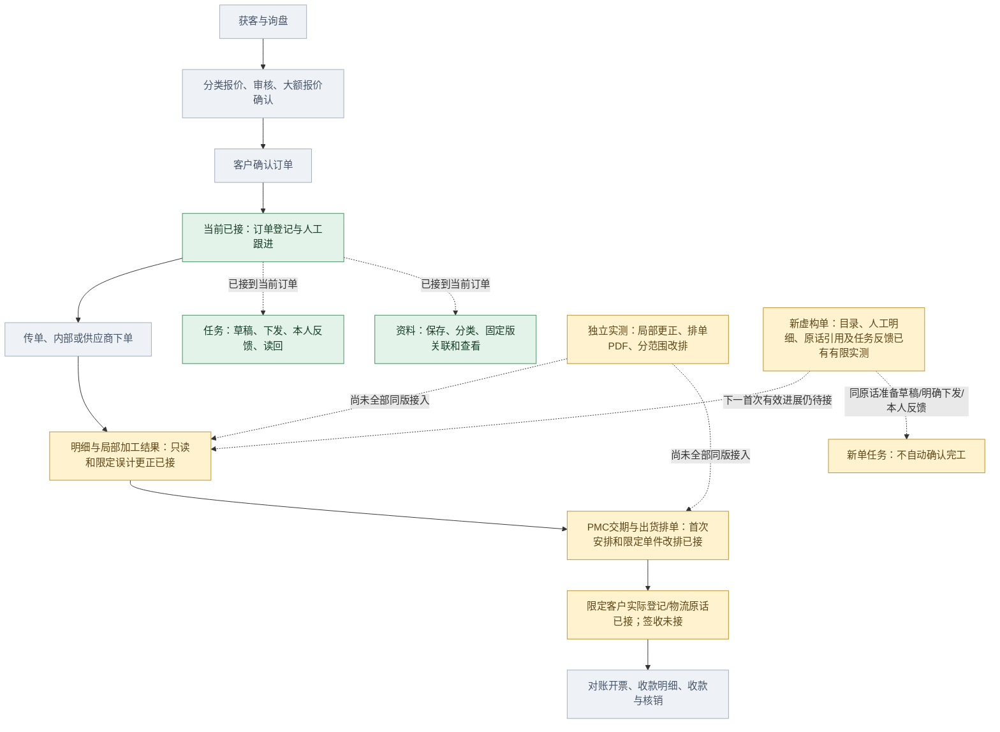

# 总流程与当前小样覆盖

2026-10-30 · revision 10；supersedes r9，r9字节留项目外line-task-handoff-prototype-20261030/docs-before-two-hour-results/10.md；以下历史；supersedes r8，r8字节留项目外line-overview-prototype-20261030/docs-before-overview-results/10.md；以下历史；supersedes r7，r7字节留项目外line-note-prototype-20261030/docs-before-direct-results/10.md；以下历史：supersedes r6，r6字节留项目外line-source-prototype-20261030/coverage-r6-before.md；以下历史：supersedes r5，r5字节留项目外manual-lines-prototype-20261030/docs-before-result/4.md；以下历史：supersedes r4，r4字节留项目外same-shipment-prototype-20261030/docs-before-s2；以下历史：supersedes r3，r3字节留项目外same-plan-prototype-20261030/docs-before-a3；以下历史：supersedes r2，r2字节留项目外same-result-prototype-20261030/docs-before-f2；以下历史：supersedes r1，原字节留项目外detail-progress-prototype-20261030/docs-before-d2 · proposed覆盖说明。来源：主管业务流程图、基础功能总图及S2/S6限定实测；运行覆盖不等正式员工软件交付，不按框数计算完成率。

## 目前占总流程哪一段

旧同单链涉及订单跟进、任务、资料、限定更正／改排及指定实际登记／物流原话；新虚构单另已普通人工建立明细。两组没有按名字拼接，未办理公司真实订单／确认／发货。任务和资料是横向支撑，不是额外两个业务步骤。

绿色为当前限定小样接通；黄色为部分覆盖、独立验证或下一段待接；灰色为当前小样未接。箭头为业务联系，不是每张单必走的制度。报价大额分支、任务/资料独立存在、签收与开票/收款并非总是严格串行。

客户经营、客服品质、汇报、维修审厂、人员权限与统计仍在完整规划，未因本图只画订单主线而取消。AI在基础路径之外作后续增强。

当前证据：[同一订单S2/S4/S6](../../AI调研/技术验证/2026-10-30-同一订单接续与切任务保护阶段记录.md)；新增[同单明细与局部进度D2只读实测](../../AI调研/技术验证/2026-10-30-同单明细与局部进度只读实测.md)；后续见[明细与局部进度接续卡](../施工与验收/订单明细与局部进度接续卡.md)。

本r2补充：同单明细及局部结果只读已有限运行，结果和明细为合成预置；普通反馈不算正式加工，原安排不改为实际。仍以黄色部分覆盖表示，不把这一步计为生产管理全部完成。

本r3补充：[同单F2](../../AI调研/技术验证/2026-10-30-同单局部误计更正与原操作查回实测.md)已从普通页面办理局部误计更正；原2件/资格/来源预置，首次加工确认仍缺，原安排不自动改。仍是黄色部分覆盖，非生产板块全部完成。

本r4补充：[本单A2/A3](../../AI调研/技术验证/2026-10-30-同单核查意见草稿与单件改排实测.md)已接意见/草稿/仅改S02的采用与原版回查。当前仍黄色部分覆盖；真实实际发出/物流未接，独立PDF不是本轮同版输出。

本r5补充：[同单S2](../../AI调研/技术验证/2026-10-30-同单实际发出与物流原话实测.md)已接一件客户实际登记及人工物流线索；正面来源/资格为夹具，不是发货指令或客户签收。原款项、正式物流状态/签收与全部交付能力未完成，仍黄色部分覆盖，不按框数算进度。

本r6补充：[人工明细首段](../../AI调研/技术验证/2026-10-30-人工明细首次录入与原操作查回实测.md)在独立新O-ID普通建两行／保存重开，数量与physical piece分开，不自动生成完工／发货。上图J不表示已把旧预置S01/S02接到新ML行，仍黄色部分覆盖；下一来源关联只备方案。

本r7补充：[明细关联已存原话](../../AI调研/技术验证/2026-10-30-明细关联跟进原话与原操作查回实测.md)已在新M9同O-ID有限运行，保固定v1和人工关系；原话不自动生效为加工或发货，J仍不接旧S01/S02结果。下一从明细直接补一句raw＋引用仅候选，首次有效进展仍待依据。

本r8补充：[明细下直接补记](../../AI调研/技术验证/2026-10-30-明细下直接补记与同事务关联实测.md)已同事务保存主原话与引用，不生成加工／计划／实际，也不拼旧S2逐件结果。J仍部分覆盖；下一只读跟进清单只是候选，不替首次有效进展依据。

本r9补充：[同单明细跟进只读清单](../../AI调研/技术验证/2026-10-30-同单明细跟进只读清单实测.md)已集中当前可读原话、展开与回本行保稿；LO1／停后P1证据分开。J仍黄色部分覆盖，清单不算正式完成量，下一选单入口仅候选，首次有效进展与旧结果映射仍未接。

本r10补充：[OD2/H3](../../AI调研/技术验证/2026-10-30-目录选单原话派事与恢复接续实测.md)把新ML原话接到既有任务命令，引用不是独占行，回复不是阶段结果；J/N仍部分覆盖。新单资料入口和首次有效进展尚未合，恢复也只限所记范围，不按图框计算整套完成率。
