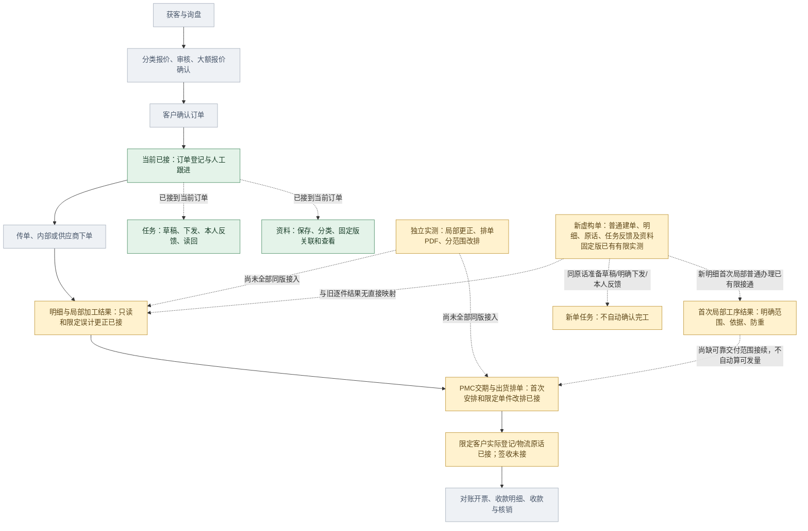

# 总流程与当前小样覆盖

2026-10-31 · revision 20（前版字节见项目外delivery-overview-prototype-20261031/docs-before-delivery-results/3.md）（前版字节见项目外dispatch-link-audit-20261031/docs-before-link-design/1.md）（本段修订前字节见项目外page-context-prototype-20261031/docs-before-pc2/3.md）；supersedes r16（原字节见项目外line-note-resume-prototype-20261031/docs-before-nr2-results/5.md）；以下历史：revision 16；supersedes r15（原字节见项目外line-query-guard-prototype-20261031/docs-before-final-timed-result/2.md）；以下历史：revision 15；supersedes r14（原字节见项目外line-query-guard-prototype-20261031/docs-before-qg1/5.md）；以下历史：revision 14；supersedes r13（原字节见项目外range-note-prototype-20261031/docs-before-rn2/7.md）；以下历史：revision 13；supersedes r12（原字节见项目外local-history-prototype-20261031/docs-before-history-results/6.md）；以下历史：revision 12；supersedes r11，原字节留项目外local-progress-prototype-20261031/docs-before-result/3.md；以下历史：supersedes r10，原字节留项目外morning-entry-prototype-20261031/coverage-before-morning.md；以下历史：supersedes r9，r9字节留项目外line-task-handoff-prototype-20261030/docs-before-two-hour-results/10.md；以下历史；supersedes r8，r8字节留项目外line-overview-prototype-20261030/docs-before-overview-results/10.md；以下历史；supersedes r7，r7字节留项目外line-note-prototype-20261030/docs-before-direct-results/10.md；以下历史：supersedes r6，r6字节留项目外line-source-prototype-20261030/coverage-r6-before.md；以下历史：supersedes r5，r5字节留项目外manual-lines-prototype-20261030/docs-before-result/4.md；以下历史：supersedes r4，r4字节留项目外same-shipment-prototype-20261030/docs-before-s2；以下历史：supersedes r3，r3字节留项目外same-plan-prototype-20261030/docs-before-a3；以下历史：supersedes r2，r2字节留项目外same-result-prototype-20261030/docs-before-f2；以下历史：supersedes r1，原字节留项目外detail-progress-prototype-20261030/docs-before-d2 · proposed覆盖说明。来源：主管业务流程图、基础功能总图及S2/S6限定实测；运行覆盖不等正式员工软件交付，不按框数计算完成率。

## 目前占总流程哪一段

旧同单链涉及订单跟进、任务、资料、限定更正／改排及指定实际登记／物流原话；新虚构单另已普通人工建立明细。两组没有按名字拼接，未办理公司真实订单／确认／发货。任务和资料是横向支撑，不是额外两个业务步骤。

绿色为当前限定小样接通；黄色为部分覆盖、独立验证或下一段待接；灰色为当前小样未接。箭头为业务联系，不是每张单必走的制度。报价大额分支、任务/资料独立存在、签收与开票/收款并非总是严格串行。

客户经营、客服品质、汇报、维修审厂、人员权限与统计仍在完整规划，未因本图只画订单主线而取消。AI在基础路径之外作后续增强。

当前证据：[同一订单S2/S4/S6](../../AI调研/技术验证/2026-10-30-同一订单接续与切任务保护阶段记录.md)；新增[同单明细与局部进度D2只读实测](../../AI调研/技术验证/2026-10-30-同单明细与局部进度只读实测.md)；后续见[明细与局部进度接续卡](../施工与验收/订单明细与局部进度接续卡.md)。

本r2补充：同单明细及局部结果只读已有限运行，结果和明细为合成预置；普通反馈不算正式加工，原安排不改为实际。仍以黄色部分覆盖表示，不把这一步计为生产管理全部完成。

本r3补充：[同单F2](../../AI调研/技术验证/2026-10-30-同单局部误计更正与原操作查回实测.md)已从普通页面办理局部误计更正；原2件/资格/来源预置，首次加工确认仍缺，原安排不自动改。仍是黄色部分覆盖，非生产板块全部完成。

本r4补充：[本单A2/A3](../../AI调研/技术验证/2026-10-30-同单核查意见草稿与单件改排实测.md)已接意见/草稿/仅改S02的采用与原版回查。当前仍黄色部分覆盖；真实实际发出/物流未接，独立PDF不是本轮同版输出。

本r5补充：[同单S2](../../AI调研/技术验证/2026-10-30-同单实际发出与物流原话实测.md)已接一件客户实际登记及人工物流线索；正面来源/资格为夹具，不是发货指令或客户签收。原款项、正式物流状态/签收与全部交付能力未完成，仍黄色部分覆盖，不按框数算进度。

本r6补充：[人工明细首段](../../AI调研/技术验证/2026-10-30-人工明细首次录入与原操作查回实测.md)在独立新O-ID普通建两行／保存重开，数量与physical piece分开，不自动生成完工／发货。上图J不表示已把旧预置S01/S02接到新ML行，仍黄色部分覆盖；下一来源关联只备方案。

本r7补充：[明细关联已存原话](../../AI调研/技术验证/2026-10-30-明细关联跟进原话与原操作查回实测.md)已在新M9同O-ID有限运行，保固定v1和人工关系；原话不自动生效为加工或发货，J仍不接旧S01/S02结果。下一从明细直接补一句raw＋引用仅候选，首次有效进展仍待依据。

本r8补充：[明细下直接补记](../../AI调研/技术验证/2026-10-30-明细下直接补记与同事务关联实测.md)已同事务保存主原话与引用，不生成加工／计划／实际，也不拼旧S2逐件结果。J仍部分覆盖；下一只读跟进清单只是候选，不替首次有效进展依据。

本r9补充：[同单明细跟进只读清单](../../AI调研/技术验证/2026-10-30-同单明细跟进只读清单实测.md)已集中当前可读原话、展开与回本行保稿；LO1／停后P1证据分开。J仍黄色部分覆盖，清单不算正式完成量，下一选单入口仅候选，首次有效进展与旧结果映射仍未接。

本r10补充：[OD2/H3](../../AI调研/技术验证/2026-10-30-目录选单原话派事与恢复接续实测.md)把新ML原话接到既有任务命令，引用不是独占行，回复不是阶段结果；J/N仍部分覆盖。新单资料入口和首次有效进展尚未合，恢复也只限所记范围，不按图框计算整套完成率。

本r11补充：[上午新单整段与恢复](../../AI调研/技术验证/2026-10-31-新单整段与恢复续办实测.md)已在同一新AM单普通连起明细／原话／任务反馈／资料两版固定v1；新建本机集群恢复及恢复副本续录各分方法。AM3前端修补不回套AM2恢复包。首次局部进展现只有[独立数据库最小验证](../../AI调研/技术验证/2026-10-31-首次局部进展范围与防重数据库最小验证.md)，无新普通办理／HTTP，仍黄色。范围ID不证明物理不重叠，不能把实验2＋2当全单4件；真实G03／G04／G06、完整同版产物及Windows／公司内外使用未验。

本r12补充：[LP3／LP4](../../AI调研/技术验证/2026-10-31-新明细首次局部结果普通办理与查原实测.md)补新明细的首次局部2件普通办理／查原／重开；依据保存不自动生效，范围和合成资格仍预置，未接公司完工制度。P仍黄色部分覆盖，当前新增模块恢复包未验；不把旧逐件／改排／实际链硬接或按框数计算完成率。

## 本次只补过程跟进的操作回查，不扩大流程完成率

[本单本人历史与刷新查原实测](../../AI调研/技术验证/2026-10-31-本单本人历史与刷新查原实测.md)覆盖“本单本人成功记录发现→只读查原”及同标签页待查刷新后GET，属于查询／操作保护的横向支撑；不新增报价、检验、发货、签收、对账或收款完成。新局部范围仍预设，HR5新测试范围不是普通建立也不证明不重叠。主候选303项包恢复已有普通新入口证据，本机70分钟只读观察仍待结束，不代整版、EXE或员工验收。

## 可选范围写法属于过程跟进补记

[RN2范围表达](../../AI调研/技术验证/2026-10-31-可选范围说明原话与恢复实测.md)补“明细下说清所指范围”的可选辅助和原话找回，声明不认证可信范围／完工，不增加发货、物流或财务覆盖。整行4件只是所选明细已录数量，另一行未知仍未知；局部结果仍2件，全单累计仍未知。RN2同版恢复和HR4长观察按不同版本读，不按页面或检查个数算整套完成率。

## 查询等待保护仍属横向支撑

[QG1](../../AI调研/技术验证/2026-10-31-查原读取超时保护与同版恢复实测.md)使原话查原读超时可再查，不增加任何正式加工、排车、物流或收款完成。最新小样与同版恢复按QG1，HR4长观察另计，不能算总流程新增覆盖比例。

## 本轮最终证据分界

HR4本机只读70分钟已实际结束并保持数据；QG1另有查原超时和自身同版恢复证据，不能互相回套。特殊复制文字的匹配差异仅源／模型确认待修，完整业务覆盖没有增加；不据139样本、303文件或检查总数算完成率。

## 本段仍是跟进与查询保护

[NR1／NR2刷新接续](../../AI调研/技术验证/2026-10-31-明细补记特殊文字与刷新查原实测.md)补明细文字回执兼容和原次查询，不新增正式加工、排车、签收或收款完成；全单累计仍未知。304文件、模型或检查项都不换算为功能完成率。

## 顶部统一提示属于横向使用支撑

[PC1／PC2](../../AI调研/技术验证/2026-10-31-当前订单顶部提示与待查入口实测.md)使当前单／读取状态和本页待查入口更明显，未增加询盘、报价、审核、排车、发货或收款覆盖。任务资料独立上下文不据选单贴标签；整套仍为局部拼接候选。下一先核旧排车物流与新明细关联，不用菜单数或304包文件计算完成率。

## 本轮定位了新旧交付接入的三处缺口

[接入核对](../../AI调研/技术调研/2026-10-31-排车物流与新明细接入条件核对.md)确认：新ML数量／局部范围未映射旧piece；独立日排单／分范围改排的表未装入PC2；旧计划读接口只取一项安排，不能代表全部车次。当前图纠正旧“首次进展仍待接”箭头：LP4已有有限普通局部进展，但交付接续仍缺。下一[只读交付概览图纸](订单交付概览与排车物流接入图纸.md)未执行，不据保存审计增加业务覆盖／完成率。

## 本轮补交付只读入口，不增加新单交付办理完成

[DO1／DO2](../../AI调研/技术验证/2026-10-31-订单交付概览只读接续与同版恢复实测.md)把本单各安排head/history、旧实际与物流显示在当前订单页，仍黄色部分覆盖；额外两项安排／新AM空读资格为专用夹具，不能算新单从人工明细普通排车／发货。306包恢复和窄屏也不换算为功能完成率；原图缺可靠交付范围箭头保持。
