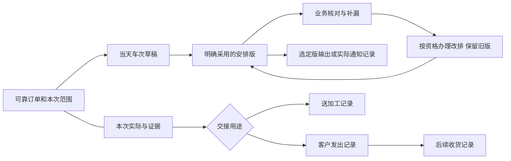

# 每日出货排单与未出货跟进操作稿

2026-10-29 · revision 4 · proposed；supersedes r2，r2原字节保留项目外logistics-and-binary-before/；本版仅补新物流／收款联动来源，原排单候选不改为已批；supersedes r1，原r1所审字节和后加流程图的r1快照均保留项目外continuous-business-plan-20261029/dispatch-design/。本版据2／3号纠正“无已发依据不等未发可改”，并核实际变化；补4号所提合计例和首段输出范围。依据用户新给PMC群内核对、未排订单和每日出货排单4图的[去标识补证r2](../../AI调研/产品经理调研/2026-10-29-PMC未出货跟进与每日出货排单-需求补证.md)，结合既有在途／交付规划。**这是可审阅操作方案与纸面走查，不是已实现界面或公司制度。** 完整基础功能包含该工作；本稿推荐的最小人工排单深度尚需与试用范围收拢，不改原受审r12。

## 先看这一页

**让PMC用一张表安排当天要出的货，业务只补遗漏和变化，订单里能查到本次安排及实际发出情况。** 不要求员工把微信群每条聊天重新录入，也不靠AI才能用。

推荐先做：找获准的待交范围、人工安排日期／车次、记录必要司机／时间、核对补漏、改排留痕、分范围记录实际发出、查询和选定输出。地图路线优化、车辆定位、运费结算、自动读群／群发不在本稿范围；“车次”先按一次安排理解，不假定必须自有车辆或必须有车牌才能留草稿。

## 1. 三个入口，共用业务记录

| 入口／用途 | 默认内容及主要动作 | 避免的问题 |
| --- | --- | --- |
| 未出货跟进 | 本人获准订单及待交范围；查看安排情况、最新有据反馈、缺更新／差异；筛选日期、业务、目的地等适用字段 | 未出货不一律进“重新排车”；已排待发、尚待安排和反馈未明分开 |
| 每日出货排单 | 选日期，表格按车次分组；从获准来源加入本次范围，调整安排，明确采用该版，查实际执行；草稿有明显区分 | 不把卡片装饰挤占表格；不能保存一次就默认群发或算已发货 |
| 订单内的交付安排 | 本单各次安排、变更、本次去向和实际记录；点开精确范围／资料版本再回原位置 | 不另抄一份独立“完成台账”，不把其他订单或其他车次混进来 |

PC保留密集表格、固定关键识别列和按需展开供方／加工明细；窄屏优先车次摘要与逐项办理，横向宽表另开查看。Bento用于日期／当日概览等上层组织，核心排单仍以可比较的行列为主。这是布局建议，未作新视觉／点击验证。

图中安排／输出不直接生成实际发出；需要谁确认和采用何种证据，仍依相应公司依据。司机和业务人员分别只看获准的必要内容。

## 2. 一天怎样办理

| 步骤 | 谁在办（用途，不是现成权限配置） | 操作与应留下的结果 |
| --- | --- | --- |
| 找待办货 | PMC／跟单 | 从可靠订单范围选取；看当前安排和实际依据，必要信息可带出；资料不齐先留缺口，不猜地址／数量／日期 |
| 排当天车次 | 有对应安排权者 | 选本次客户交付或送加工的范围、日期及车次；必要时间／司机已知才填；未准备好保存草稿 |
| 明确采用安排 | 有对应安排权者 | 一次明确办理，使新安排版可供后续使用，旧版仍可回查；这不是默认加主管审批，实际资格／生效条件待核 |
| 核对遗漏／变化 | 相应业务／跟单 | 从本单／本排单项简短反馈，可靠对象／版自动带出；普通反馈不暗中改车次、日期、订单要求或实际出货 |
| 调整安排 | 有对应安排权者 | 检查本次所见安排、当前相应实际事实及可调整范围是否仍适用，只改有据可调整的部分；实际未明可留草稿／改排请求，不因缺记录就采用整批改排。记录改排原因／差异；旧通知和已发生事实不改写 |
| 补本次实际 | 有记录资格者；正式适用另按依据 | 留实际发出／送加工的对象、范围、时间及来源。仅是转述则留反馈；条件齐备的有权者可明确办理，不要求每条备注走审批 |
| 查回和输出 | 按当前权 | 同条件看当日／车次、订单和选定输出；失权、不完整和读取失败分别说明，不用空白装作已完或0条 |

司机信息属于安排需要时的最少字段，不因此引入司机全套人事管理、给司机整单权或公开电话。系统内反馈／任务可复用，向微信发送、通知已读及所有业务员确认都没有被默认实现。

## 3. 信息怎么放，员工才不用反复抄

| 信息 | 来源／带出方式 | 必须分开的含义 |
| --- | --- | --- |
| 订单／客户／业务及供方线索 | 可靠订单和获准基础资料；按需展开 | 订单识别与本次排单项不同；原料供应与加工供应不相加 |
| 本次范围、件数、重量 | 明确明细／工件或已核范围；未知留出并保留原话 | 订单总量与本次安排量、实际发出量分别显示。不能把同单总重量在每车重复相加；无本次重量不按比例猜分 |
| 去向和目的地 | 客户交付／送加工等目的及已核地址；保留安排当时可用信息 | 同一工件先送加工再发客户是不同事件，不重复当客户完成 |
| 时间 | 客户要求、需出货时点、拟出车、实际发出、收货各按来源 | 原“出货日期”中动作说明留来源，不强解析；跨日使用完整日期时间，不能只存“第二车”或“晚上” |
| 车次、司机／经手 | 一次车次安排身份及已知人员引用／当时显示值 | 第二车不是永久唯一身份；司机／时间变更不改旧通知和已发事实 |
| 版本、来源及本次操作 | 安排版、采用结果、反馈所指版、实际证据和原操作结果 | 当前有效安排、草稿、已撤安排、历史实际分开；查历史成功不复活旧安排 |

概念关系是“订单范围→排单项→日期车次的安排版”，另接对应实际交付事件／证据。任务与资料只是可靠引用，不靠附件名、同一段文字或群截图颜色关联。这里不定物理表、DDL或API。

### 页面不要用一个总状态吞掉全部事情

分别给出：安排情况、实际执行及证据情况。例：“已安排第三车；本次实际发出未更新；有一条待处理改期反馈”。缺反馈不证明没有执行，已排不证明已发，业务已回复也不证明差异已办理。色标可以辅助，但须有文字、来源和范围，不能颜色单独决定数量。

## 4. 改排、分批和重试：同一组虚构范围走查

本段是新纸面例“排单戊”的展开，不替换固定甲乙、丙丁或J-01/J-02；工件代号和数量全部虚构。

前提：订单戊已知需求10件，范围H01—H10有可靠一一对应；H01—H04计划本次客户交付，H05—H06是送加工，其他范围尚无本次安排。各例明确给定的实际证据不由草稿或截图颜色推导。

| 情况 | 正确的候选结果 | 要拦住的错误 |
| --- | --- | --- |
| H01—H04选到当天第二车，尚未采用草稿 | 本人可续编草稿；下游仍只看到有资格看的现行安排 | 草稿即正式下发、即客户已发4件 |
| 明确采用后拟改到第三车；本例另给有据核实H01—H04仍待发、尚可改排且无结果未明的冲突 | 新安排覆盖相应可改范围，原版和差异可查；原通知仍指原版，必要重通知是单独实际动作 | 第二、三车各把同四件都算待发／已发；旧通知自动变第三车 |
| 已有可靠实际记录H01—H02客户发出；本例另给H03—H04仍可改排的有据条件 | 保留前两件实际事实，只对后两件继续安排；旧四件计划保持历史 | 把已发生2件再改排、把历史4件加实际2件累计6件完成 |
| H05—H06送加工并有接收线索 | 留加工交接用途、对应范围及证据性质；后续客户交付另记 | 把加工方收货算客户收货、把两次运输相加成客户完成4件 |
| 本单总重量已知，本次分批重量未知 | 显示本次重量待核和缺覆盖；订单总重量只能按订单层使用 | 每个车次都加整单重量，或未知重量当0 |
| 两人同时改同一范围，后一人所见版已旧 | 不覆盖较新安排；保留本次输入、查当前差异再明确处理 | 后保存者静默抹前改动；用新键盲重发旧安排 |
| 安排版未变，但拟改H03—H04期间新增有据H03已发记录 | 采用时还要核当前相关实际／范围变化；保留H03事实和本次输入，明确冲突再处理 | 只凭安排版号没变就把H03重新排车，或静默缩成H04却称原请求全成功 |
| 提交采用／改排后回复超时 | 先查这次原操作；原内容合法重试回原结果，未明不报成功或失败 | 重排成第二个安排项，或恢复旧版为“当前” |
| 只收到“都出了”且范围不明 | 原话反馈关联已知对象，数量／覆盖不明不计客户已发量 | 把整单、同车其他单或待核加工都清完 |
| 客户改地址／取消未发范围 | 先留变更请求，按实际资格办理；影响相应未来安排，历史地址／发出事件保留 | 新地址自动改所有旧版输出，删除已发或擅自作退货／退款 |

没有已发依据不等于已经核实未发；已有部分已发也不证明其余都未发。相关实际未明或有冲突，只留待处理请求／草稿与缺口，不自动重排；无关且依据齐备的安排可以继续。这里不规定统一新审批，而是明确正常例的输入前提及正式采用时必须保护的事实。

只有需求、同单位范围、有效客户发出事实及相应取消／退回等口径齐备时，才可给相应剩余量；否则展示有据范围和缺覆盖，不能拿总需求减几条反馈当真实余量。

## 5. 表格、核对与输出要交付什么

默认日排单按日期／车次分组；一行是一项本次安排范围，可展开该订单的供方明细和关键跟进。订单数按稳定订单去重，排单项数、件数、车次数分名；不把多行当多订单，不把客户发货与加工转运混算。

| 产物 | 应标明什么 | 实际验收要看什么 |
| --- | --- | --- |
| 当日安排表／打印 | 日期、车次、采用版或草稿水印、选择范围、必要字段与生成时点 | 改排前后能辨识，不夹带不获准内容；页续表头／完整范围无截漏；不冒充已发证明 |
| 业务核对清单 | 本人获准范围、原项、待核／缺口、反馈及处理状态 | 已反馈不等全部已核；重复提出的同一原问题不变两笔已发货 |
| 实际执行清单 | 本次实际记录、用途／范围、来源性质／时点，待核内容分列 | 与订单内同条件查询对应；计划、反馈及实际不相加 |

先选一种普通输出做真实产物对照，再决定额外格式；本稿未实现打印／导出或决定正式格式。原图按车次便于人读的合并单元格可用于展示，数据交互和导出明细需保留完整行键／字段，不以空白继承上行。未定导入，旧截图可作资料，不能自动当可靠结构化业务记录。

### 同一纸面例怎样核合计，不只写口号

继续虚构戊，并新增独立虚构己（J01—J02两件）。本例已知戊H01—H02实际客户发出2件；其余实际不作0处理。采用安排v2的**待执行区**如下：

| 稳定订单 | 本次范围 | 用途 | 车次 | 本次待执行安排件数 | 本次重量 |
| --- | --- | --- | --- | --- | --- |
| 戊 | H03—H04 | 客户交付 | 当天第三车 | 2 | 未知 |
| 戊 | H05—H06 | 送加工 | 当天第二车 | 2 | 未知 |
| 己 | J01—J02 | 客户交付 | 当天第二车 | 2 | 未知 |

所选v2待执行范围应得到：稳定订单2张、排单项3项、车次2次；客户待执行安排4件、送加工安排2件分别显示，不合称客户已发6件。实际区另列已给定的客户发出2件，不回灌到待执行区。重量覆盖不足只能说本范围重量未齐，不能显示合计0；不据这张局部表推全公司当日总量。

未来选定同一v2／权限／范围的表格和打印或导出，应能逐行对应上述3项；若输出同时带实际区，明确分区及各自口径。这个期望对照是纸面验收卡，不是已经生成或验证的真实产物。

## 6. 施工建议、复用和定稿缺口

建议按同一业务成果分三段：

1. **人工排单可用：**可靠范围选择、草稿与明确采用、按日车次表格和订单回查，保留未排／已排待执行／缺更新区别；一开始就考虑当前权、重试和版本。首段包含系统内供业务核对的获准清单／回查；若要据此用于现场试用，应同时交一种选定范围的基本打印或导出并实际对账，不能只交编辑界面。
2. **改排与实际可对照：**分范围改排、原通知版本、实际发出／送加工及反馈办理分层；防重复和错误清完整单。
3. **核对和产物一致：**补漏／改排／实际同源对照，扩充必要产物并完善旧版与未知值说明，再与目标环境／成套恢复／维护交付组合验收；首段基本输出不推迟到这里才开始。

这是候选实现顺序，不是另批正式编码或锁定日期。完整归属沿B09/P06/K5，复用W07/08/10/11/12/13/14及贯穿W15/16；日排单具体任务需对应细分，不声称旧W行已覆盖其全部实现。原36B与16W行不改。

已查[两类开源思路与限制](../../AI调研/技术调研/2026-10-29-出货排单开源思路比较.md)：借鉴车次聚合、范围引用、变更防重复和分批边界；不采用库存过账作排单、不照搬拣货算法、不因此更换技术栈。外部项目源码和抓取快照全部留项目外，未装／运行／复制业务代码。

仍需对应岗位依据：未排定义与候选筛选、采用／改排资格及条件、实际发出／加工接收依据、通知时点和输出字段。集中原G03/G04/G05，助手先查资料，不向新实习生发整套问卷。不假定司机必须注册账号或每次安排都走审批；正式应用前落实相应规则，其他可独立设计继续。

### 本轮回读及修正边界

2号914、3号915实际只读原r1（hash d598fa1f…）指定§1—4／§2—4，均指出缺已发依据不能推出未发可改；3号另指出安排版不变时实际也可能变化。1号据此修上述正例／改排步骤，并加跨动作冲突行。4号916读原r1§4—6及开源r1，核其固定取样7文件，建议合计例接产物和首段包含可核对结果；本版已采纳，开源r2并精确其“提交时”限制。流程图及本次新增合计例不冒称已获三方全文审。全部仍为设计、无新业务运行／并发验证或公司制度确认。

## 7. 新物流回传与回款条件，接到排单而不混状态

用户又给5图，见[去标识需求补证r2](../../AI调研/产品经理调研/2026-10-29-物流回传与收款放行-需求补证.md)。完整基础功能明确保留：物流回传／预计到站或到客户、业务核对补漏、回款任务，以及本次确有适用收款条件时与送货／通知自提的联动。当前未实现该后台，也不据截图把全部订单改成先款后货。

排单项可查相应物流来源／有据条件与待办；物流实际、当前条件、可办动作、通知／任务分开。“前款”不默认本单尾款；“已到”地点不明留未知，到站不等客户签收、通知自提不等已提、业务称客户已付不等到账。无可靠订单／批次时先独立留线索，不凭客户号把多单合计或放行。

当前有效条件与满足依据要在真正办理时核，旧催收／通知／回执保原版及覆盖；条款新版不改旧消息，旧成功查回不复活旧条件或重放行。不强加每条审批、不默认司机可见欠款全部金额，不自动外发微信。具体试用深度与实际规则仍收拢并集中G项核实。

## 8. 物流后半程：员工最少做什么（纸面走查）

本段接§7及4号[固定版本开源对照](../../AI调研/技术调研/2026-10-29-收款条件与交付放行开源对照-4号.md)，只收敛人工操作；信用额度、订单预收款和每次交付条件不同，不把外部默认规则当公司制度。沿原物流辛／壬，不换甲乙或排单戊己。

| 谁在什么时候操作 | 可复用／带出的已知上下文 | 人最少补什么 | 留给下一岗位的结果 |
| --- | --- | --- | --- |
| 跟单收到物流新回传 | 若本次可靠关系已明确，带交付范围／对应单；否则先独立留线索 | 原文或简短变化、消息来源；地点和时间已知则填，不知道留未知 | 本次回传可查，原预计及原话时点仍在；不因客户号相同就把多单合并 |
| 业务核对本人的回传清单 | 带原行／具体交付范围和本次读取时点 | 有无遗漏、需补的具体变化；不要求重抄客户／整单资料 | 一条有来源的反馈或明确待核事项，未反馈与已核分别显示 |
| 有本项前款条件时跟进 | 带可获准查看的条件原文／适用范围／当时版；未知先保留 | “客户说已付”等新线索及依据；真正核实者另留核实记录 | 付款陈述、凭据与已核实款项分层；不自动入账／核销，不按同金额跨单抵扣 |
| 有权者拟办送货或通知自提 | 查当前适用条件与满足依据、当前动作资格及范围；旧任务保原版 | 在有据条件允许时明确办理本次动作，例外按真实授权留理由 | 安排／通知的结果可查，实际送达／提走另有记录；不默认每条再加审批 |

### 顺着原辛／壬检视，不用程序代定公司规则

1. **辛到站且客户说已付。** 物流只增加有据到站，付款回复仍是线索；本项前款条件是否满足待核。可安排业务跟进，不自动记到账／放行，也不把同客户另项套同限制。
2. **辛后来取得明确核实依据。** 只在有据覆盖的条件部分显示该依据；办理下一动作时核当前条件及资格，未发生末端送达就不补为已送到。具体收齐阈值／例外制度本例不编。
3. **辛旧任务发出后条件变了。** 旧任务及回复继续指旧沟通版，新适用条件用于后续判断；合法旧成功查回不新办一次。多个条件的组合及变更生效依真实规则，不擅定一律“且／或”。
4. **壬从预计变成“已到、待通知自提”。** 保留两次来源和时点；地点不明先核位置，有据通知与实际提货分开，不能看到绿色或“已到”就写已签收。

上述为按已给前提进行的**纸面逻辑检视**，没有物流／收款软件运行、真实到账判断、金额合计或公司制度认证。当前虚构演示已把辛／壬画进交付款项草图供讨论；后台未建。真实源对象、版本及权限仍需对应设计；当前任务桥只支持已存跟进引用，不能直接宣称已能从物流行或客源行创建可靠引用。

页面草图保留日排单／送货／款项结构的折叠入口，只有布局和普通展开观察；不能据此说日排单／物流／收款已实现。当前没有给实习生新增问卷，G03/04/05及原款项缺口仍集中。
