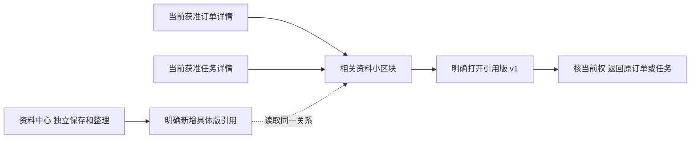

## 2026-10-29任务桥增量｜revision 3

supersedes r2，r2原字节存项目外task-bridge-docs-before。[限定实测](../../AI调研/技术验证/2026-10-29-跟进准备任务草稿与跨账号迟回实测.md)已实际从已保存跟进准备本页任务草稿，带固定ID／版／所属单重核；标题、要求、接收人和期限不代填，不自动保存／下发。参考原文只在发起人当前获准区，发布必要内容另写；来源不可读保原绑定而不变独立，任务重开更新来源候选。C4普通链、C5故障／迟回、C6提示分别留证。下方“后续由此派事”是原设计时点；资料只读dialog与任务准备是两种入口，不混成上传／AI／完整任务产品。

# 订单、任务和资料：关联入口与整段走查

2026-10-29；revision 2；supersedes r1，r1逐字保留项目外related-prototype-20261029/docs-before。候选设计与当前限定执行分开。承接用户“好，下一步”：检查实际使用路线，减少重复填写与跳页。本轮为源码／既有运行证据核对、页面方案及下一次执行卡，未新增运行接口或改演示服务。

## 当前增量：本段只读执行已完成

用户“下一步、”已承接原§4执行卡，[实测与截图](../../AI调研/技术验证/2026-10-29-相关资料只读入口与固定版返回实测.md)已有订单及任务相关区→固定v1→返回原位置的普通操作证据。为避免跨页清新稿，实际用原页面内只读dialog，保持原表单DOM；返回只核目标当前权、刷新资料区，不重新show编辑表单。这是对原跨页候选的明确取舍，不是全部草稿／公司权限已验。下文“尚未运行”保留r1设计时点。

## 先看这一页

**下一处优先补订单详情里的“相关资料”小区块。** 员工打开一张订单，就能看到本人获准查看的相关资料，点开当时引用的具体版本，看完返回原单。资料中心仍是完整保管入口；任务里以后沿同一方式呈现相关资料。

先把已经存好的资料读顺，比同时再加上传／派事／审批更容易判断问题，也能直接减少找编号、切页面和手动切版本。基础路径不用AI。

| 当前实际情况 | 本次安排 |
| --- | --- |
| 订单能记跟进，任务能下发／反馈，资料能保存／分类／引用 | 保留这些已验证的小路径，不重做 |
| 资料页能选获准订单或已发布任务建立引用；业务页没有反向资料入口 | 先设计只读相关资料区，不报它已运行 |
| 任务当前引用一条跟进记录，不是直接选一张订单 | 后续“由此派事”应带可靠跟进ID／版本和其订单，仍只打开草稿 |
| 资料当前可有v2，订单／任务引用仍可能是v1 | 入口明确“查看引用版v1”；最新版另作明确查看，不能自动替换依据 |

## 1. 员工实际要走的路线

当前手工路线：订单查看／记跟进→切任务模块→新建后另选源跟进→存草稿／明确下发→员工按本人的任务权回复→发起人查看→切资料中心→选资料具体版和获准目标关联→回订单再选原单。**关联目标已有下拉，不需要手输关联ID；重复查找主要发生在跨页与返回。** 只有任务权的员工走任务路线，不要求其打开整单。

建议逐步变成：

图是候选路线，不代表图上所有按钮已实现。当前仅F→A有新资料小样证据；O/T→R→V→B尚未运行。

## 2. 订单详情怎样排

延续现有Bento，不再增加一整层主导航。订单概要在上，跟进记录仍是主要操作；“相关资料”是下方独立小卡，在窄屏跟随主内容排列。

> **相关资料**　　刷新本区块  
> 排期沟通说明　·　**引用版 v1**　·　54字节  
> 当前分类：沟通补记　｜　当前标签：排期、待确认  
> 关联时所见订单版：v1　｜　当前资料另有v2  
> **查看引用版 v1**  
> 标题／分类／标签为本次读取到的整理信息，不冒充旧版当时标题。

打开后是指定版本只读视图：原文、版本、大小、来源、读取结果和“返回原订单”。不在此视图放保存／补交新版／关联提交按钮；若后续允许进入整理入口，要由有权人另明确进入，不让一次查看产生写操作。此布局是文字草图，不是新网页截图。

显示和动作规则：

- 上下文带具体订单ID／所见版，服务核当前人及对象权；不凭客户名称、标题相似或浏览器传来的“老板”字段匹配。
- 只列当前获准看到的资料引用。数量是本次获准列出的数量，不报隐藏数量或“还有N份无权”。合法空写“本次获准范围内暂无相关资料”；失败写“相关资料暂未读出”，不当0项。
- 一份资料在本目标下引用v1／v2时，明确分别呈现版本；同一引用身份不得因查询连接产生重复行。后续分页若未读完整，不把当前页数量当总数。
- 版本缺失／损坏只提示该版暂不可用，不退到同名新版，不抹掉另有当前权的订单和任务正文。
- 打开与返回都核当前权；切号、换单、换任务、换引用后，旧回复不得写进新上下文。资料读取失败只处理该块，确实失去目标权才清相应目标投影。
- 跳页先检查原页未保存文字、任务回复、资料整理输入和结果待查。未保存先留在原位置并提供明确继续／放弃；结果待查先查原操作，不把它当可放弃草稿。成功回执不能清掉后来新输入。

## 3. 这次发现的三个技术接缝

| 当前源码／证据 | 为何不能直接拼接 | 候选处理 |
| --- | --- | --- |
| `file_routes.py`的`target`同时校当前读权和目标版本相等；`refs`遇HTTPException直接跳过 | 订单以后正常升版，旧引用可能在读取时被隐藏；目前只读发现该风险，未在运行库造升版复现。也不能把核权暂不可用等异常都吞成空 | 读取分开“当前能否看此目标”与“关联时所见版”；按可靠kind＋id取旧引用，保留其目标版本和资料具体版。写关联仍校所见版冲突，不借读需求降低写校验。历史目标正文另核权，不因显示关联版本就开放旧业务内容 |
| `/api/materials?q=`是可见标题／标签／分类／关联编号的字串查找 | 把订单编号塞进去不能保证只得到精确关联该订单的资料，标题里碰巧有相同字符也能命中 | 新相关区须精确关系读取并核双方权限，不能用通用搜索冒充反向关系。读投影缺口明确留施工，不先把全库元数据送浏览器过滤 |
| `files.js`的`open(mid)`／`show(m)`默认当前最新版，并带整理／新版／关联表单 | 直接复用会跳成v2，或误称只读入口；其返回也未携原目标 | 只读入口携引用身份＋资料ID＋明确版，服务核关联成立及该版可读；目的页固定此版、标当前整理信息，返回保留原上下文并重新核权 |

任务当前边界另注明：`task_routes.py`的`check_reference`按跟进ID／版查其订单并核权；仅发起人得到`safe_reference`，接收人按当前owner／active recipient资格读取必要任务正文。不能为了反向资料而给接收人开放源跟进、整单或全部原件。当前只有发布版v1，不借此段另建任务修订流程。

**实现取舍：**建议复用现有业务服务／PG关系和逐请求授权，新增很小的只读投影及页面区块。只搬关系、不复制正文、不另装工作流或搜索平台。已有[传输与保管职责复核](../../AI调研/技术调研/2026-10-28-资料中心传输与保管职责复核.md)继续沿原查证日期，未重新选底座或声称今日核过上游；本段没有不熟悉组件需要从零实现或新增依赖。

## 4. 下一次最小执行卡：只读关联资料

候选只在项目外停止副本中执行、固定虚构数据、本机回环，原查看服务保持，原件／DB成对复制。先做订单相关资料区，再将同一机制用于已发布任务；不带真实公司资料或新依赖，不改旧订单／任务／引用／资料版。

| 步骤 | 具体做什么 | 将来验收预期，非本次通过 |
| --- | --- | --- |
| ① 固定基线 | 沿FS2的2资料／3内容版／2个v1引用，独立冻结原业务、资料记录和字节hash | 不拿接口库ID拼界面库，不修改旧副本，不创建新订单／文件来凑路线 |
| ② 精确读 | 从获准目标查当前人可列出的具体版引用；同名同文但未关联的项排除 | 只见本目标确有且获准的条目，无未过滤总数／隐藏资料标识 |
| ③ 普通打开／返回 | 从订单／任务点引用v1，只读54字节旧原文，返回原对象 | 新v2仍在但不被替代打开；仅GET，无上传／关联／发布操作；原输入守卫有效 |
| ④ 有意失败 | 原件缺失、资料读取失败、目标读取失败、资料权撤去、旧回复迟到 | 各显示相应暂不可用／当前获准结果；不把失败当0，不串账号／对象，不丢仍获准正文或新稿 |
| ⑤ 版本分离 | 在专用测试集合模拟当前目标升版，但旧引用仍指当时目标v1和资料v1 | 若同一目标当前可读，仍可列原引用和所指资料版；不改关系／回填最新版，历史业务正文不额外开放 |
| ⑥ 对账／退出 | 前后全字段及原字节对账，正常停自有服务／PG／映射 | 原业务／资料／引用／成功操作无增量；查看副本另记，不因测试停而解除别的S映射 |

表④⑤需要专用虚构夹具和受控故障，不在真实查看库操作。仅从URL读到一个ID不算关联授权；先核所指关系和当前目标／具体版读取资格。此卡不是正式开发或全部权限／并发／灾备验收。

## 5. 事实、回读与仍待验证

- 依据：[资料实测r1](../../AI调研/技术验证/2026-10-29-资料保存分类与业务引用小样实测.md)§6、[订单稿r3](订单详情与人工跟进操作稿.md)§7、资料操作稿r3、权限r1／数据r9及当前项目外原始源码。项目外`route-design-20261029/sources-before.json`冻结12份原文／代码hash。
- 原2号882只读现有三JS及指定原稿给出手工路线／三处问题／第一优先入口；原3号881只读当前服务与前端给出版本／授权／固定版视图边界。两者没有运行，也未重审本合稿。
- 本轮尝试继续普通浏览器观察时，控制器报告观察连接不可用；已按文档查当前tab并重新取得，仍不可用，停止重复尝试。tab清单显示原演示仍在62833，不能据此称新路线点击已通过。**本次完成的是源码核对和候选页面／执行设计，没有新增GUI／API运行证据。**
- G03真实权限、类别上报、加工完成、舍入及维护承接沿原集中缺口。具体公司制度未核，但不妨碍先把只读路径和验证边界写清；不再给同事发整套问题。

### 合稿后指定回读

2号884实际只读“先看这一页”及§1／§2，3号883只读§2／§3／§4并看§5限制，在各自范围未报必须修改的实质冲突；二者读取时SHA256均为`64359b02aab707ef800da0b76919d6240e11788ff52362cce24af9c17477433c`。该版本逐字保存在项目外`route-design-20261029/reviewed-r1.md`。当前只附加本回执说明，不把这些静态意见称全文、接口、普通GUI或公司制度验收；未重跑原实测。

## 6. r2执行回填

原§4已在隔离虚构小样执行有限片段；新只读接口与源模块小卡存在，旧业务／资料／引用前后不变。当前查看54428约10:18到期，旧62833独立沿09:39到期，不动其S。RD1首GUI失败保留，RD2实际CUA／25API加收尾／8假DOM分证据；任务回复草稿+原件打开的正例复合普通UI仍未验。正式业务／真实权限／新安装／Git／关机边界不变。
