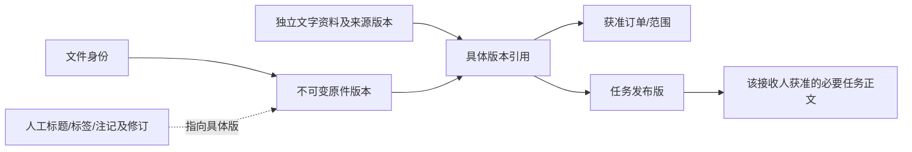

# 资料中心：人工归档与业务引用操作稿

2026-10-29；revision 4；supersedes r3（r3原字节保留项目外binary-prototype-20261029/docs-before/），补本次限定二进制查看；以下原修订保留：supersedes r2（r2逐字存项目外docs-before）；以下原设计以2026-10-28 r2为历史基线；supersedes r1，已回读r1原字节保存在项目外reviewed-r1；proposed。承接用户“开始”和上一段“梳理资料怎样归档、关联订单和任务”。**r2当时只完成操作设计；r3已增加下述限定运行证据。** 原任务片段自身仍只办任务；不把连续推进扩成真实资料上传、正式业务开发、安装或生产授权。

## 最新实际增量：小型截图与PDF可保管查看

用户承接最小清单§5后，已做[PNG/JPG及两页PDF限定实测](../../AI调研/技术验证/2026-10-29-截图与PDF保管及指定版查看实测.md)：普通选择器保管、原字节／类型、PNG旧版引用、任务内PDF及原稿返回、顺序核权、原操作查回和PDF模块故障后同页重试分别留证。不改正式订单／任务。下文r3“图片／反向入口未实现”为当时时点；最新仍不含上报、OCR、视频、大文件和真实权限或全部首批通过。测试B1/B2已正常收尾，另有59330临时副本至12:44，先核status。

## 当前增量：限定执行已完成

用户2026-10-29“好，那就下一步”已授权原§4的小样。现有手工文字／小txt保存、整理、固定版关联和按权找回的有限运行证据，见[实测](../../AI调研/技术验证/2026-10-29-资料保存分类与业务引用小样实测.md)。下文“尚未启动／无运行”描述的是原r2，不覆盖该新结果；图片视频、上报、反向业务页附件入口仍未实现，真实权限／正式开发仍未批准。

## 先看这一页

员工把值得留下的文字／文件放进资料中心，**可以先不分类、不关联订单**。保存后能按名称、标签或获准业务对象找回；以后确认属于哪张订单、哪个任务，再建立引用。资料整理和基础查找不依赖AI；系统推荐分类留到有依据的后续增强，当前不伪造推荐。

页面用三个区域：**放资料 → 我的获准资料清单 → 所选资料和引用**，延续Bento分卡；文件夹是逻辑组织，不是让员工填写服务器磁盘路径。r2当时只有布局说明；r3的当前资料页面及截图见上述实测。

| 员工想做什么 | 主要输入／页面动作 | 成功后实际留下什么 |
| --- | --- | --- |
| 先留住内容 | 粘贴文字或选择文件；可补标题和标签，允许“暂未分类”；有可靠上下文可提前选择关联候选 | 资料身份、明确的文字来源／原件版本、服务记录人和时间；只说明保存结果，不自动上报或确认进度 |
| 补分类和说明 | 选类别／标签，写“本人补记、摘录、复述”等性质；不知道的发生时间留未知 | 新的整理记录／所见版；不改原字节，不把人工说明伪装成客户原话或OCR |
| 关联订单或任务 | 选本人获准且可靠识别的订单／任务及具体资料版本，再明确办理关联 | 一条可回查的引用。一个版本可被多个对象分别引用；不复制成新订单或自动放开原件权限 |
| 找回或打开 | 按名称、标签、资料编号或获准业务对象筛选；按权查看指定版本 | 明确匹配或暂不可用；未识别图片／音视频不承诺内文全文搜索，查不到不等于公司没有 |
| 补交新版 | 对原资料明确“新增版本”，保留旧版本 | 新字节版本；旧任务／订单仍引用原版，不因最新上传悄悄换依据 |

默认“保存”和“关联”各有结果。若未来同一页面提前选关联并一次办理，须明确显示两步及分别结果，并且用户本次允许先独立保管；**只请求关联失败时，不能偷偷另上传或另存一份。** 原“允许提前选择”保留，不固定给员工增加两次点击或统一审批。

## 1. 页面具体放什么

~~~text
资料中心
┌ 放资料 ───────────┬ 获准资料清单 ──────────────────────┐
│ 粘贴文字／选文件 │ 标题｜类别/待整理｜保存结果｜关联范围 │
│ 标题、标签可补   │ 筛选：名称、标签、可靠订单/任务       │
│ 关联可选、可后补 ├ 所选资料 ──────────────────────────┤
│ 保存资料         │ 原文/原件具体版｜人工说明｜关联记录   │
│ 原操作查回       │ 整理、确认关联、新增版本（分别核权） │
└──────────────────┴─────────────────────────────────────┘
~~~

“已保存／待整理／未关联／上报状态”分别表达，不挤成一个总状态。**上报按资料类别决定**：触发规则未定的类别不设置自动上报，也不统一添加“再上报一次”按钮；已上报记录须指向当时版本，后添版不倒改历史。

列表只返回当前可见项；无存在性权限时不显示隐藏文件名、ID、数量、链接或“有附件但无权”。允许看目录／标题、预览、整件下载、整理和关联分别核资格；真实公司矩阵G03继续待核。

## 2. 资料怎样与订单、任务相连

每条关联保存对象身份、具体资料／注记版本、必要位置、操作者和时间；同名、同字节、同客户或AI相似都不能自行证明属于同一单。任务发布后，新增资料引用是独立关系，不改原发布正文、接收人、期限或旧反馈。后续若要修订已下发任务本身，另做明确版本流程，本次不实现。

任务接收人只收到获准的必要任务正文；原件存在、标题、预览和下载另核。发布者能打开文件不等于能转发全件；任务所需说明应在获准正文中独立成立。撤去文件权后不能借旧任务回执下载，也不随意删除另有当前权的任务正文和反馈。

## 3. 用资料丁核一遍：哪些改变，哪些保持

以下全虚构、仅纸面推演，未创建这些文件／数据库记录。丁是一份合成说明v1，员工有独立保管权；发生时间未知。甲是既有虚构订单，任务甲沿既有发布版作引用目标，不更改其正文。

| 情况 | 预期结果 |
| --- | --- |
| 丁先独立保存，暂不选类别或业务对象 | 已保存／待整理／未关联并列；按本例类别未上报。不造第三张订单，不通知老板 |
| 有可靠对应及动作权后，给甲关联丁v1 | 新增引用，丁和甲原内容不变；从甲找到的也必须经过当前资料权限 |
| 给既有任务关联丁v1，但handler只有任务正文权 | handler仍能读任务和本人回复；不新增丁的标题、编号、附件计数或下载入口。不能假称任务已经拥有附件展示功能 |
| 关联失败或回复未明 | 先保管成功的丁保留；只报关联未成／待查，查该关联原操作。只做关联者没有另存副作用 |
| 同名新字节丁v2、或给另一单另加引用 | v1字节和旧引用保留；新版本／新关系单独核权。同名不覆盖，同字节不合并业务和权限 |
| AI关闭或提取失败 | 获准原件及人工标题／标签可找；原件保留，未识别内文不冒充可搜索 |
| 某块读取失败／切号／确实撤权 | 读取失败只标受影响块暂不可用，需核权而不可核的动作暂停，不推定其他已可靠获准能力都失效；切号清旧账号内容，确实撤权清相应受限投影。合法空与读取失败分开，旧回执不绕权 |
| 文件已收但登记失败／登记在而指定字节缺失 | 只报待核／暂不可用；不生成假“已保存”或偷换同名版。不得擅自删除孤立字节或原合法资料 |

本表是候选验收预期，不是8项产品测试。固定单号／任务ID在执行前从各自测试库可靠映射，避免重演任务T1接口库／界面库ID混用。

## 4. 下一次最小执行卡（建议，尚未启动）

目标是把同一条人工基础路径搬到普通界面，**先用独立文字＋两个合成UTF-8 `.txt`小文件**验证：保存、人工标签、指定版引用、按权找回及原操作查回。暂拟每文件不超过64 KiB，纯属实验资源边界，不是公司产品容量或格式限制；实际字节／摘要须执行前冻结，不调用真实公司原件。

按先后验五段：①独立文字保存／重开；②小文件具体版本保存／读取与同名两版；③可靠关联订单及既有任务，接收关系不搬权限；④超时原键查回、拒绝及读取失败不串稿；⑤核原订单／跟进／发布正文／回复全字段不变，正常关闭自己测试服务，查看副本另记。

先查已存同类实验，不重复跑旧续传／恢复全套。新增重点是**当前业务身份和PG办理与真实文件选择器接起来**，以及存储成功但SQL失败时不误报已保存。资料字节与数据库不宣称单事务：受控暂存／核字节→固定不可变位置→事务登记版本／原操作；失败留待核，按原操作对账，直到登记成功才发布可用版本。崩溃清理及其他失效点另验，目录／视频续传、OCR/AI、预览转换、外部通知、类别上报、删除、云服务及EXE不在这张执行卡。

这张卡沿W11／W12／W14及W01必要片段，不新增任务号或锁正式技术栈。G03真实权限、类别上报触发、保留期限、维护方等继续原集中缺口，当前不向同事追加问卷。正式公司使用仍须相应依据。

## 5. 依据和实际完成程度

- [数据r9第10节](../数据与接口/报价与进度关键数据及办理边界.md)：保管、注记、关联、按类别上报和多阶段结果。
- [现有资料管理设计r1](../业务流程与权限/基础配置与资料管理设计.md)及[跟进操作稿r3第7—8节](订单详情与人工跟进操作稿.md)：原件／注记／人工路径和任务衔接。
- [本轮技术职责复核](../../AI调研/技术调研/2026-10-28-资料中心传输与保管职责复核.md)：已有实测能复用哪里，上传组件不能代办什么。

2号867、3号865、4号866分别只读既有原文，提供业务／权限／已有上传恢复证据；合稿r1后2号870回读先看一页／§1—3、3号869回读§1—4、4号868回读标题／§4及技术职责§1／§3。各限定范围未报实质矛盾；2号指出“某块读失败”不该与切号／撤权合为全页停用，r2据此收紧这行，三者没有重审r2或重跑产品。没有重扫公司原件、运行新上传、改旧演示、安装依赖或推Git。原首批r12、数据r9、固定卡、两旧HTML、权限r1及16条任务原行保持。

## 6. 已授权小样回填与后续走查

原§4已执行，W11／W12／W14仅有局部证据：独立文字、小txt两版、整理修订、资料页到订单／已发布任务的指定版引用、原操作找回。保存不等上报，引用不改业务正文，不授接收人原件权。文件与PG失败间隙确有受控实验，任意崩溃／清理／大文件／细粒度权限未验。下一段先设计从订单／任务找资料的短路径和整段使用走查；没有反向API先不报完整闭环。
